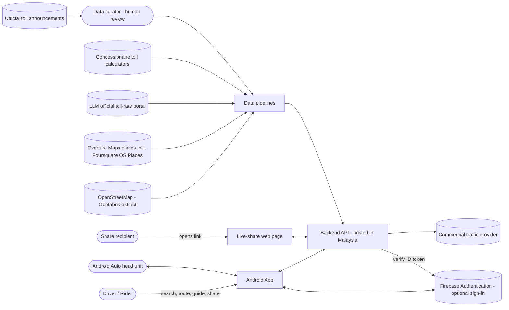
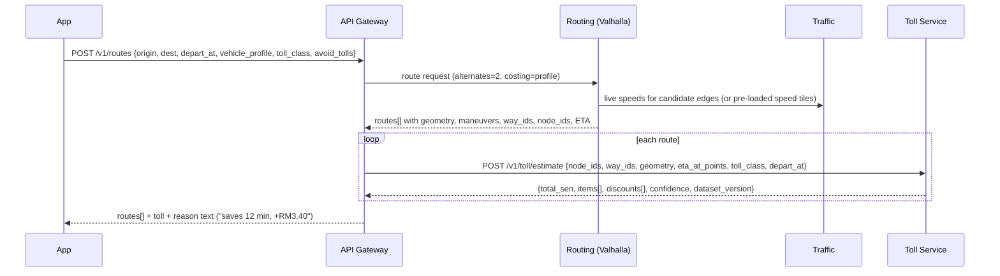
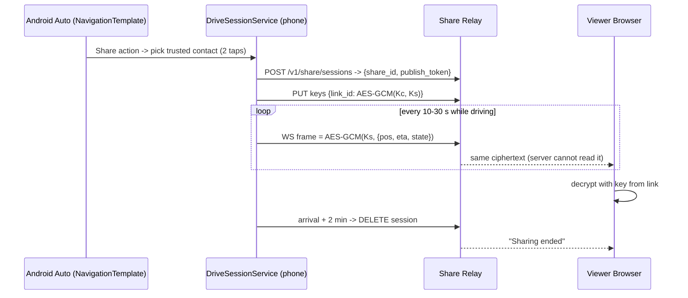

# 03 — System Architecture

## 1. Architecture goals (from requirements)
1. Navigation quality first: accurate search, routing, guidance, live traffic (FR-01/03/04, NFR-01).
2. Toll estimates that are correct, explainable and current (FR-05/06, NFR-06).
3. Privacy and sovereignty by design: minimal data, opt-in probes, hosted in Malaysia (NFR-02/07).
4. Works degraded: offline, provider outage, poor coverage (FR-10, NFR-05).
5. Open, licence-clean data; no Google Maps Platform content (D2).
6. Android only: the phone and Android Auto are one experience driven by one drive session (D8, D9; detail in 06).

## 2. Context diagram

## 3. Container / component diagram

```mermaid
flowchart TB
  subgraph Mobile["C-01 Android App (Kotlin, Jetpack Compose) - detail in 06"]
    UI[C-01a UI & Simple mode]
    MAP[C-01b MapLibre renderer]
    NAV[C-01c Guidance engine - voice BM/EN]
    LOC[C-01d Location & map-matching]
    TOLL_L[C-01e Toll engine - on-device copy]
    OFF[C-01f Offline packs: tiles, search, routing, toll data]
    PRIV[C-01g Privacy manager & dashboard]
    SHARE_C[C-01h Live-share publisher]
    AUTO[C-01i Android Auto car app - Car App Library]
    SVC[C-01j DriveSessionService - foreground, type=location]
  end

  subgraph Backend["Backend - Malaysian cloud region"]
    GW[C-02 API gateway - auth optional, rate limits]
    ROUTE[C-03 Routing service - Valhalla]
    SEARCH[C-04 Search service - Typesense]
    TILES[C-05 Vector tiles - PMTiles on object storage + CDN]
    TRAF[C-06 Traffic service - provider adapters + probe aggregator]
    TOLL[C-07 Toll service - authoritative engine]
    SHARE[C-08 Share relay - E2E ciphertext only - see 07]
    REPORT[C-09 Crowd reports & place edits]
    DB[(C-10 PostgreSQL + PostGIS)]
    CACHE[(C-11 Redis)]
    OBJ[(C-12 Object storage)]
  end

  subgraph Pipelines["Offline data pipelines (scheduled)"]
    P_OSM[C-13 OSM build: tiles + Valhalla graph + address index]
    P_POI[C-14 POI build: Overture + OSM + user edits -> search index]
    P_TOLL[C-15 Toll data pipeline: crawl -> diff -> validate -> review -> publish]
    ADMIN[C-16 Curator console]
  end

  UI --> GW
  UI --> SVC
  AUTO --> SVC
  SVC --> NAV & LOC & SHARE_C & TOLL_L
  SHARE_C --> SHARE
  GW --> ROUTE & SEARCH & TOLL & TRAF & SHARE & REPORT
  MAP --> TILES
  ROUTE --> TRAF
  ROUTE --> TOLL
  TOLL --> DB
  REPORT --> DB
  SHARE --> CACHE
  TRAF --> CACHE
  P_OSM --> OBJ
  P_OSM --> ROUTE
  P_POI --> SEARCH
  P_TOLL --> DB
  P_TOLL --> OBJ
  ADMIN --> P_TOLL
  ADMIN --> REPORT
  OFF --> OBJ
```

## 4. Component specifications

| ID | Component | Technology (recommended) | Responsibilities | Notes |
|---|---|---|---|---|
| C-01 | Android app | Native Kotlin, Jetpack Compose, MapLibre Native Android / MapLibre Compose, Hilt, Room, DataStore, WorkManager; Android Auto via `androidx.car.app` 1.7+ | UI, rendering, guidance, offline, sharing, car app | Module layout and drive-session design in 06 §2–3 |
| C-02 | API gateway | Caddy in front of the Ktor API (08 §6) | TLS, rate limiting, anonymous device tokens, Firebase ID-token check for optional accounts | No login needed for core APIs (FR-09); accounts in 08 §7 |
| C-03 | Routing | **Valhalla** on OSM `malaysia-singapore-brunei` extract | Route alternatives, costing per vehicle profile, toll avoidance, map matching for trip logs, returns OSM way/node IDs along the route | Supports custom speed data for traffic (see §6) `[VERIFY]` exact traffic ingestion method for the chosen Valhalla version |
| C-04 | Search | **Typesense** (typo tolerance + geo search) | Places & addresses, BM/EN/ZH/TA aliases, category filters, proximity ranking | Index built by C-14 |
| C-05 | Tiles | Planetiler → PMTiles; MapLibre style with BM/EN labels | Base map; offline region packs | Static files, CDN-cacheable |
| C-06 | Traffic | Adapter interface; v1 adapter: commercial provider free/paid tier; v2: opt-in probe aggregation | Live speeds/incidents per road segment, mapped to OSM ways | See §6 |
| C-07 | Toll service | Kotlin/JVM service embedding the same `:core:toll` library as the app | Route → plazas → fares → discounts → breakdown + confidence | Full spec in `04-toll-estimator.md` |
| C-08 | Live share | WebSocket relay (C-08), static share page (C-08b), notifier for Web Push/FCM (C-08c) | Relays end-to-end-encrypted frames; keeps only the latest ciphertext per session | Full design in `07-location-sharing.md` |
| C-09 | Reports & edits | REST + moderation queue | Hazards, closures, missing places | Rate-limited, anti-abuse |
| C-10 | Database | PostgreSQL 16+ with PostGIS | Toll data (temporal), reports, place edits, share session metadata | No raw GPS traces stored |
| C-13–15 | Pipelines | Containerised jobs on a scheduler | Weekly OSM/POI builds; nightly toll crawl | Reproducible, versioned outputs |
| C-16 | Curator console | Simple admin web app | Approve toll changes, discount events, place edits | Every approval audited |

### 4.1 On-device vs server split
| Function | Online | Offline (FR-10) |
|---|---|---|
| Map display | CDN tiles | Region PMTiles pack |
| Search | C-04 | Small on-device index of the region (SQLite FTS) — reduced coverage |
| Routing | C-03 | Phase 8 (10 §12): on-device Valhalla tiles for region (`[ASSUMPTION]` feasible size; spike needed) |
| Traffic | C-06 | None (show "no live traffic") |
| Toll | C-07 | C-01e with cached dataset version (shows dataset date) |
| Share | C-08 | Not available |

## 5. Key flows

### 5.1 Plan a route with tolls (FR-04/05/06)

### 5.2 Live location sharing while driving (FR-07, FR-21)

Full design, encryption and safety rules: `07-location-sharing.md`.

### 5.3 Search quality gate (FR-01)
- Maintain `search_test_list.csv`: ≥300 Malaysian queries (malls, clinics, schools, small attractions such as
  themed studios/cafés, kampung names, highway R&Rs, Sabah/Sarawak towns) with expected coordinates.
- CI fails the POI build if top-3 hit rate < 90% or drops > 2 points from the previous build.

## 6. Traffic design (C-06)
- **Interface:** `TrafficProvider.getSpeeds(bbox|edge_ids) -> [{osm_way_id, direction, speed_kph, confidence, observed_at}]`
  and `getIncidents(bbox)`.
- **v1:** one commercial provider adapter (e.g., TomTom Traffic Flow/Incidents; free tier ≈ 2,500 non-tile and
  50,000 tile requests/day `[VERIFY]` — sufficient for development, not for production scale). Map provider
  segments to OSM ways by map-matching provider geometry once per release (stored lookup table).
- **v2 (opt-in probe traffic; design adopted from 12 §2):**
  - Off by default; turned on in the privacy dashboard.
  - Uploads use **single-use blind-signature tokens** (Privacy-Pass style): the server can verify a token is valid
    but cannot link it to the device that obtained it. No account, device or trip ID; the probe endpoint does not
    log IP addresses.
  - The phone trims the **first and last ~500 m of every trip** and anything inside privacy zones (07 §5.1) before
    upload; samples are snapped to OSM way IDs with direction and a 5-minute time bucket.
  - Raw samples deleted ≤ 24 h. Kept long-term: only per-way, per-direction speed averages per **quarter-hour of the
    week** (no dates, no IDs). Live speeds shown only when **≥ 5 independent samples** agree.
  - Blend: provider speed weighted by confidence + probe speed when the k-threshold is met.
- **Feeding the router:** refresh a live-speed overlay for Valhalla every 1–5 min (exact mechanism depends on
  Valhalla version `[VERIFY]`); fall back to historical/typical speeds.

## 7. API surface (v1, REST/JSON)

| Method & path | Purpose | Auth |
|---|---|---|
| `GET /v1/search?q=&near=&lang=&limit=` | Place/address search | Device token |
| `POST /v1/routes` | Route alternatives with ETA and toll | Device token |
| `POST /v1/toll/estimate` | Toll for a given path (also used by trip log) | Device token |
| `GET /v1/toll/dataset/latest` | Version + URL of on-device toll bundle | Public |
| `/v1/share/...`, `GET /s/{share_id}`, `GET /c/{link_id}` | Live sharing (links, sessions, encrypted frames, viewer page) | See 07 §10 |
| `POST /v1/reports` · `GET /v1/reports?bbox=` | Crowd reports | Device token |
| `POST /v1/places/suggest` | Missing/incorrect place | Device token |
| `GET /v1/privacy/export` · `DELETE /v1/privacy/data` | PDPA export/delete | Device token |
| `/v1/me`, `/v1/sync/...` | Optional accounts and sync | Firebase ID token — see 08 §7.3 |

Response for toll is defined in `04-toll-estimator.md` §8.

## 8. Data stores (summary)
- PostgreSQL/PostGIS: toll tables (temporal), reports, place edits, share metadata, audit log.
- Redis: live share state (TTL), traffic speed cache.
- Object storage: PMTiles, Valhalla tiles, offline packs, toll dataset bundles, raw toll-source snapshots.

## 9. Security & privacy architecture (NFR-02, NFR-07)
- Host all services and data in a Malaysian cloud region `[VERIFY]` provider availability/terms.
- Anonymous device token by default; optional account only for cross-device sync.
- No raw GPS traces stored server-side; route requests logged without coordinates (only coarse region + timing)
  and deleted after 24 h.
- Probe data: opt-in, pseudonymous rotating token, aggregated with k-anonymity before storage.
- Live share: end-to-end encrypted (keys in the link's `#fragment`, never sent to the server); the relay keeps only
  the latest ciphertext frame per session and deletes it at session end; IDs ≥128-bit random (07 §4).
- PDPA (as amended 2024): appoint DPO, breach-notification runbook (notify the Commissioner promptly — guidance
  indicates within 72 h — and affected users if significant harm), data-portability export endpoint,
  records of processing. `[VERIFY]` current guidelines.
- Search and routing request contents are never logged; caches use keys not linked to a user and expire ≤ 10 min;
  per-device daily quotas (NFR-13).
- No advertising/analytics SDKs that receive location. Crash reporting scrubbed of coordinates.
- Publish a "Who gets what" page (NFR-07) listing the traffic provider and what it receives (bounding boxes,
  not user identities).

## 10. Deployment
**For the first 10 users, use the single-VM Docker Compose setup in `08-tech-stack-and-accounts.md` §6.** The points
below describe the later, larger setup.
- Containers on a managed Kubernetes or simple VM set in one Malaysian region; second zone for HA.
- Valhalla: 2+ replicas, graph tiles rebuilt weekly from OSM; blue/green swap.
- CDN in front of tiles and share pages.
- Observability: metrics (latency, route failures, toll confidence distribution, pipeline freshness), logs
  without PII, alerting on NFR SLOs.

## 11. Phased roadmap

Superseded by `10-build-phases.md`, which defines Phase 0 (foundations) and MVPs 1–8 with work packages,
exit criteria and AI prompts.

## 12. Risks
| Risk | Mitigation |
|---|---|
| POI coverage gaps for small Malaysian venues | Search gate, user place edits, add licensed local sources if gate fails |
| Traffic cost at scale | Cache aggressively per segment; opt-in probe data later (10 §13) |
| Toll source site changes/blocks crawler | Multiple sources, saved-HTML parser tests, manual curation fallback, seek a data-sharing arrangement with LLM |
| OSM toll tagging incomplete in Malaysia | Phase 0 audit; maintain own plaza table keyed to OSM node IDs (04 §3) |
| Licence non-compliance | Attribution screen, licence registry in 05 |
| Android Auto quality review rejects the app | Follow 06 §4 rules from day one; DHU screenshot audit (AA-10); simulated drive via `onAutoDriveEnabled` |
| Poor Bahasa Malaysia text-to-speech on some phones | Test common Malaysian devices in Phase 0; pre-recorded BM prompt fallback (06 §4.3) |
| Live sharing misused to track someone | Safeguards in 07 §8; visible indicator cannot be disabled |
