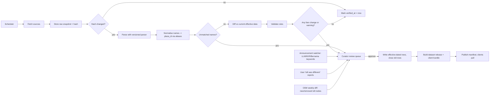

# 04 — Toll Estimator Design

Implements FR-05, FR-06, FR-15, FR-19 and NFR-06. Owner components: C-07 (server), C-01e (on-device), C-15 (pipeline), C-16 (curator console).

## 1. Principles
1. **Official data first.** Fares come from the LLM toll-rate portal, cross-checked against concessionaire
   calculators. Never invent a fare; if unknown, say so (confidence LOW with a range).
2. **Everything is time-dependent.** Fares, discounts, plaza roles and even a highway's toll-system type have
   effective periods. Estimates are computed for the time the vehicle passes each plaza.
3. **Explainable.** Every estimate has a per-plaza breakdown, dataset version, "verified as of" date and confidence.
4. **One library, two runtimes.** The engine is a pure Kotlin/JVM library (`:core:toll`, no Android dependencies).
   The Android app embeds it (C-01e) and the server (C-07) runs the same code on the JVM. The JSON fixture suite (§9)
   is still the contract.
5. **Money in integer sen.**

## 2. Malaysian toll facts the model must represent
| Fact | Modelling consequence | Evidence |
|---|---|---|
| Two systems: **open** (flat fare per plaza) and **closed** (entry recorded, fare at exit by entry→exit pair) | `plaza_role` + `open_fare` + `closed_fare` tables | Carsome toll guide; LLM portal |
| A closed fare network can span highways and operators (e.g., the LPT2 calculator lists plazas it says are not operated by LPT2) | `toll_network` separate from `highway` and `operator` | LPT2 website |
| The official LLM portal returns per-class fare **and distance** for a highway + entry plaza + exit plaza | Primary crawl source; store `distance_km` per pair for validation | kadartol.llm.gov.my |
| Vehicle classes 1–5; some plazas use their own scheme incl. motorcycles (Penang Bridge) | `class_scheme` per plaza; mapping from vehicle profile to class per scheme | Carsome; Prolintas class definitions |
| Rates are frozen/raised by government decision; 2026 freeze for 10 highways | Effective-dated fares; "no change" confirmations update `verified_at` only | RTM/NST Dec 2025 |
| Festive discounts (e.g., 50% for Class 1, Class 2 at Penang Bridge) with **excluded plazas** and exact start/end times | `discount_event` with scope, class rules, exclusions, rounding | LLM statement, Dec 2025 |
| A highway may change from closed to open system | `highway_system_period` | Kajang–Seremban Highway history |
| Stretches can be de-tolled (gazetted toll-free), changing closed fares | Closed matrix re-crawled; change sets | Malay Mail, 2018 (Sungai Besi stretches) |
| Barrier-less gantries (ANPR/RFID) are being piloted; SLFF from 2027, MLFF later | `plaza.kind = gantry`; same fare logic; payment hints separate | The Edge, The Star 2026 |
| Payment methods vary (TNG card, RFID, SmartTAG, open payment cards) | `plaza_payment_method` for UI hints only (never affects fare) | E-15; open-payment rollout news |

## 3. Data model (PostgreSQL DDL, abridged)

```sql
-- Provenance
CREATE TABLE source (
  source_id      TEXT PRIMARY KEY,              -- 'llm_kadartol', 'plus_calc', 'lpt2_calc', 'llm_press', 'osm'
  kind           TEXT NOT NULL,                 -- 'portal' | 'calculator' | 'announcement' | 'osm' | 'user'
  base_url       TEXT,
  trust_rank     INT NOT NULL                   -- 1 = most authoritative
);
CREATE TABLE source_snapshot (
  snapshot_id    BIGSERIAL PRIMARY KEY,
  source_id      TEXT REFERENCES source,
  url            TEXT NOT NULL,
  retrieved_at   TIMESTAMPTZ NOT NULL,
  content_sha256 TEXT NOT NULL,
  object_key     TEXT NOT NULL,                 -- raw HTML/JSON in object storage
  parser_version TEXT NOT NULL
);

-- Network topology
CREATE TABLE operator (operator_id TEXT PRIMARY KEY, name TEXT NOT NULL);
CREATE TABLE toll_network (network_id TEXT PRIMARY KEY, name TEXT NOT NULL);   -- closed-system fare networks
CREATE TABLE highway (
  highway_id  TEXT PRIMARY KEY,                 -- e.g. 'E1'
  name_ms     TEXT NOT NULL, name_en TEXT,
  short_name  TEXT,                             -- 'PLUS', 'LDP', 'DUKE'
  operator_id TEXT REFERENCES operator
);
CREATE TABLE highway_system_period (
  highway_id     TEXT REFERENCES highway,
  system_type    TEXT NOT NULL CHECK (system_type IN ('open','closed','free')),
  network_id     TEXT REFERENCES toll_network,  -- required when closed
  effective_from TIMESTAMPTZ NOT NULL,
  effective_to   TIMESTAMPTZ,                   -- NULL = open-ended
  source_id      TEXT REFERENCES source
);

-- Plazas & gantries
CREATE TABLE class_scheme (scheme_id TEXT PRIMARY KEY, description TEXT); -- 'LLM_1_5', 'PENANG_BRIDGE', ...
CREATE TABLE plaza (
  plaza_id     TEXT PRIMARY KEY,                -- stable internal ID, e.g. 'E1-JURU'
  highway_id   TEXT REFERENCES highway,
  name_ms      TEXT NOT NULL, name_en TEXT,
  kind         TEXT NOT NULL CHECK (kind IN ('booth','gantry')),
  class_scheme TEXT REFERENCES class_scheme DEFAULT 'LLM_1_5',
  geom         GEOGRAPHY(POINT) NOT NULL,
  active_from  TIMESTAMPTZ NOT NULL, active_to TIMESTAMPTZ
);
CREATE TABLE plaza_alias (plaza_id TEXT REFERENCES plaza, alias TEXT, source_id TEXT REFERENCES source,
  PRIMARY KEY (plaza_id, alias, source_id));   -- names as spelled by each source
CREATE TABLE plaza_osm_ref (
  plaza_id        TEXT REFERENCES plaza,
  osm_node_id     BIGINT NOT NULL,             -- barrier=toll_booth or highway=toll_gantry node
  in_way_id       BIGINT,                      -- way entering the plaza (defines direction)
  out_way_id      BIGINT,
  bearing_deg     REAL,                        -- direction of travel through this lane group
  PRIMARY KEY (plaza_id, osm_node_id, in_way_id)
);
CREATE TABLE plaza_role (                       -- role per direction of travel, effective-dated
  plaza_id       TEXT REFERENCES plaza,
  in_way_id      BIGINT,                       -- NULL = any direction
  role           TEXT NOT NULL CHECK (role IN ('open_charge','open_no_charge','closed_entry','closed_exit','closed_toggle')),
  network_id     TEXT REFERENCES toll_network,
  effective_from TIMESTAMPTZ NOT NULL, effective_to TIMESTAMPTZ
);
CREATE TABLE plaza_payment_method (plaza_id TEXT REFERENCES plaza, method TEXT, -- 'tng_card','rfid','smarttag','open_payment','anpr'
  effective_from TIMESTAMPTZ NOT NULL, effective_to TIMESTAMPTZ);

-- Fares
CREATE TABLE open_fare (
  plaza_id TEXT REFERENCES plaza, in_way_id BIGINT, vehicle_class TEXT NOT NULL,
  amount_sen INT NOT NULL CHECK (amount_sen >= 0),
  effective_from TIMESTAMPTZ NOT NULL, effective_to TIMESTAMPTZ,
  source_id TEXT REFERENCES source, snapshot_id BIGINT REFERENCES source_snapshot,
  verified_at TIMESTAMPTZ NOT NULL
);
CREATE TABLE closed_fare (
  network_id TEXT REFERENCES toll_network,
  entry_plaza_id TEXT REFERENCES plaza, exit_plaza_id TEXT REFERENCES plaza,
  vehicle_class TEXT NOT NULL, amount_sen INT NOT NULL CHECK (amount_sen >= 0),
  distance_km NUMERIC(7,2),
  effective_from TIMESTAMPTZ NOT NULL, effective_to TIMESTAMPTZ,
  source_id TEXT REFERENCES source, snapshot_id BIGINT REFERENCES source_snapshot,
  verified_at TIMESTAMPTZ NOT NULL
);

-- Discounts / temporary adjustments
CREATE TABLE discount_event (
  event_id      TEXT PRIMARY KEY,               -- 'xmas-2025'
  name          TEXT NOT NULL,
  starts_at     TIMESTAMPTZ NOT NULL, ends_at TIMESTAMPTZ NOT NULL,
  kind          TEXT NOT NULL CHECK (kind IN ('percent_off','fixed_amount','free')),
  value         NUMERIC NOT NULL,               -- 50 for 50%
  rounding      TEXT NOT NULL DEFAULT 'half_up_sen',   -- [VERIFY] per announcement
  applies_at    TEXT NOT NULL DEFAULT 'transaction_time', -- closed system: exit time [ASSUMPTION]
  source_url    TEXT NOT NULL,
  approved_by   TEXT NOT NULL
);
CREATE TABLE discount_scope (                   -- what is included
  event_id TEXT REFERENCES discount_event,
  scope_kind TEXT CHECK (scope_kind IN ('all','highway','network','plaza')),
  scope_id TEXT,                                -- NULL when 'all'
  class_scheme TEXT, vehicle_class TEXT         -- e.g. ('LLM_1_5','1') and ('PENANG_BRIDGE','2')
);
CREATE TABLE discount_exclusion (event_id TEXT REFERENCES discount_event, plaza_id TEXT REFERENCES plaza);

-- Change control & releases
CREATE TABLE change_set (
  change_set_id BIGSERIAL PRIMARY KEY, created_at TIMESTAMPTZ, source_id TEXT, snapshot_id BIGINT,
  status TEXT CHECK (status IN ('pending','auto_confirmed','approved','rejected')),
  summary JSONB, warnings JSONB, reviewed_by TEXT, reviewed_at TIMESTAMPTZ
);
CREATE TABLE dataset_release (
  version TEXT PRIMARY KEY,                     -- '2026.10.23-1'
  created_at TIMESTAMPTZ, change_set_ids BIGINT[], bundle_object_key TEXT, bundle_sha256 TEXT,
  min_app_version TEXT
);
```

Vehicle profile → class: a small table `class_mapping(profile, class_scheme, vehicle_class)`, e.g.
(`car`, `LLM_1_5`, `1`), (`taxi`, `LLM_1_5`, `4`), (`motorcycle`, `PENANG_BRIDGE`, `<scheme value>`),
(`motorcycle`, `LLM_1_5`, `NONE` = not charged) `[VERIFY]` motorcycle treatment per plaza.

## 4. Keeping it up to date — the data pipeline (C-15)



### 4.1 Sources and cadence
| Source | What | Cadence | Notes |
|---|---|---|---|
| S1 LLM toll-rate portal (`kadartol.llm.gov.my`) | Highway → entry plaza → exit plaza → per-class fare + distance | Nightly full crawl (enumerate highways, then plaza pairs) | Official. Be polite: ≤1 request/s, identify the crawler, respect robots/terms `[VERIFY]`; prefer a formal data request to LLM. Parser tests from saved HTML. |
| S2 Concessionaire calculators (PLUS, LPT2, others) | Same, per operator | Weekly cross-check | Disagreement with S1 → review |
| S3 Official announcements (LLM, Works Ministry, Bernama) | Rate changes, freezes, festive discounts, new plazas, de-tolling | Watch daily (RSS/keywords: "kadar tol", "diskaun tol", "toll discount", "plaza tol baharu") | Discounts are entered **manually** by a curator with source URL |
| S4 OpenStreetMap | `barrier=toll_booth`, `highway=toll_gantry` nodes, `toll=*` ways | Weekly with the OSM build | Detect new/moved/removed plazas |
| S5 Users | "Toll was different" from trip log | Continuous | Triage signal, never auto-applied |

### 4.2 Effective dates
- If an announcement gives a date: `effective_from` = that date/time (MYT), entered by curator, possibly **before**
  the portal updates (enables plan-ahead, FR-15).
- If a change is only detected by crawl: `effective_from` = start of the detection day, flagged
  `effective_from_inferred = true` in `change_set.summary`.
- Closing old rows: set `effective_to = new.effective_from`. Never delete history.

### 4.3 Validation rules (warnings route the change set to human review)
1. `amount_sen` integer, 0 ≤ amount < 50,000 (RM500) — hard error otherwise.
2. Closed matrix symmetry: |fare(A→B) − fare(B→A)| > 10 sen → warning.
3. Triangle check: fare(A→C) > fare(A→B) + fare(B→C) + 50 sen → warning.
4. Distance check: portal `distance_km` vs OSM path length between plazas on the highway ±10% → warning.
5. Change magnitude: any fare change > 20% or any change for > 25% of pairs in one network → warning.
6. Class pattern: expected ordering (e.g., class 3 ≥ class 2 ≥ class 1) violated → warning (not error; real exceptions exist).
7. Cross-source disagreement (S1 vs S2) → warning.
8. Discount events must have: source URL, explicit exclusions list (may be empty), explicit classes, start < end.

### 4.4 Releases and client update
- Each approval batch → `dataset_release` with semantic date version.
- Client bundle: SQLite containing rows effective now **and** future-effective rows (for plan-ahead), gzip,
  signed (Ed25519). Typical size target < 2 MB `[ASSUMPTION]`.
- App checks `GET /v1/toll/dataset/latest` on launch and daily; downloads on Wi-Fi or if > 7 days stale.
- Every estimate returns `dataset_version` and the oldest `verified_at` among the fares used.

### 4.5 Freshness SLOs and monitoring (NFR-06)
| SLO | Target | Alert when |
|---|---|---|
| S1 crawl completes | Every night | Two consecutive failed or partial runs |
| Source change → published release | ≤ 48 h (approval included) | Change set pending review > 24 h |
| Announced change entered before its effective date | 100% of announcements caught by the watcher | Effective date passes with no matching row |
| Highway verified recently | Every highway `verified_at` ≤ 7 days old | Any highway older than 7 days |
| Client staleness | ≥ 95% of active clients on a bundle ≤ 7 days old | Below 95% for 3 days |
| Estimate quality | ≥ 95% of route estimates at confidence HIGH | Weekly share below 95% |

Dashboards show these per highway; the curator console lists overdue items first.

## 5. Plaza detection on a route
Input from routing (C-03): ordered list of OSM way IDs and node IDs along the path, the geometry, and predicted
time at each point (`eta_at`). `[VERIFY]` the exact Valhalla response fields (e.g., route with edge way IDs, or
`trace_attributes` on the returned shape) for the chosen version.

```text
function detectCrossings(path):
  events = []
  for each consecutive (way_in, node, way_out) in path:
     for ref in plaza_osm_ref where osm_node_id == node:
        if ref.in_way_id is NULL or ref.in_way_id == way_in:
           events.append({plaza_id: ref.plaza_id, in_way_id: way_in, at: path.eta_at(node), method: "node"})
  // Fallback for plazas whose OSM refs are incomplete:
  for plaza in plazas within 30 m of path bbox without a node match:
     if distance(plaza.geom, path) <= 15 m and |bearing(path at plaza) - plaza_ref.bearing_deg| <= 45:
        events.append({plaza_id, at: eta_at(nearest point), method: "geometric"})   // lowers confidence one step
  return dedupe(sort_by_distance_along(events))
```

Why way-aware matching: closed-system plazas sit on interchange **ramps**; a route that stays on the mainline
passes within metres of them but must not be charged (fixture F6).

## 6. Fare computation

```text
function estimate(path, profile, depart_at):
  events = detectCrossings(path)
  open_entries = {}            // network_id -> entry event
  items = [], warnings = [], confidence = HIGH

  for ev in events:
     role = plaza_role_at(ev.plaza_id, ev.in_way_id, ev.at)      // effective-dated
     cls  = class_for(profile, plaza(ev.plaza_id).class_scheme)
     if cls == NONE: items.add(ev, 0, "not charged for this vehicle"); continue

     switch role.role:
       case open_charge:
          fare = open_fare_at(ev.plaza_id, ev.in_way_id, cls, ev.at)
          add(ev, fare)
       case open_no_charge:
          continue
       case closed_entry:
          if open_entries[role.network_id] exists: warn("re-entry without exit"); confidence = min(confidence, MEDIUM)
          open_entries[role.network_id] = ev
       case closed_exit:
          entry = open_entries.pop(role.network_id)
          if entry is None: add_unknown_entry(ev); confidence = LOW            // range: min..max fare to this exit
          else: add(pair(entry, ev), closed_fare_at(role.network_id, entry.plaza_id, ev.plaza_id, cls, ev.at))
       case closed_toggle:      // mainline barrier at a network boundary
          if role.network_id in open_entries: treat as closed_exit
          else: treat as closed_entry

  for (net, entry) in open_entries:          // route ends inside a closed network (planning error or trace cut)
     warn("route ends inside closed network"); confidence = LOW

  apply_discounts(items)                     // §6.1, uses each item's transaction time
  for item in items: if item.fare missing: confidence = LOW
  if oldest_verified_at(items) older than 30 days: confidence = min(confidence, MEDIUM)
  if any ev.method == "geometric": confidence = min(confidence, MEDIUM)
  return {total_sen, range_sen (if LOW), items, discounts_applied, confidence, warnings, dataset_version, verified_at}
```

`*_at(…, t)` always selects the row where `effective_from <= t < coalesce(effective_to, +∞)`.
Transaction time = time at the charging plaza (open plaza time; closed **exit** time) `[ASSUMPTION — confirm with LLM]`.

### 6.1 Discounts
```text
for item in items:
  for ev in discount_events where starts_at <= item.at < ends_at:
     if item.plaza in exclusions(ev): continue
     if not in_scope(ev, item.plaza, item.network, item.class_scheme, item.vehicle_class): continue
     item.discounted = apply(ev.kind, ev.value, item.fare, ev.rounding)
     item.discount_event_id = ev.event_id
     break                       // at most one discount per item unless an event says it stacks
```

### 6.2 Avoid-tolls and route comparison
- Routing requests "avoid tolls" by excluding `toll=yes` ways and toll nodes in Valhalla costing.
- For each alternative, show `toll_total` and the difference vs the fastest route; reason text:
  `"{minutes_saved} min faster, {+RMx.xx} toll"` or `"{n} min slower, saves RMx.xx"` (FR-05).
- Android Auto shows only the route total ("Toll RM15.25") in route rows and `tripText`; the per-plaza breakdown
  stays on the phone (06 §4.2).

## 7. Edge cases checklist
| # | Case | Handling |
|---|---|---|
| 1 | Plaza charges one direction only | `plaza_role` with `in_way_id` per direction; other direction `open_no_charge` |
| 2 | Route passes beside a plaza (parallel road / mainline past ramp plaza) | Way-aware detection; geometric fallback needs bearing match |
| 3 | Navigation starts inside a closed network (e.g., at an R&R) | Unknown entry → LOW + range; in trip-log mode use earliest trace point |
| 4 | Trip crosses two closed networks with open plazas between | Independent `open_entries` per network (fixture F7) |
| 5 | Discount window boundary (e.g., ends 23:59) | Use per-plaza ETA; plan-ahead shows "discount may not apply if you arrive after …" |
| 6 | Penang Bridge-style special class scheme | `class_scheme` per plaza |
| 7 | Highway converts closed → open on date D | `highway_system_period` + `plaza_role` effective-dated (fixture F3) |
| 8 | New plaza opens before OSM is updated | Curator adds plaza with geometry; geometric detection until OSM node exists |
| 9 | Gantry (barrier-less) | `kind = gantry`; identical fare logic |
| 10 | Cross-border (Second Link / Causeway) | Model Malaysian side plaza only; note Singapore charges are out of scope `[ASSUMPTION]` |
| 11 | Motorcycles | Per-scheme mapping; usually not charged on LLM 1–5 highways `[VERIFY]` |
| 12 | Same plaza name on different highways | Plaza IDs include highway code; aliases per source |

## 8. API contract

`POST /v1/toll/estimate`
```json
{
  "path": { "way_ids": [123, 456], "node_ids": [1, 2, 3], "polyline6": "…", "eta_at": ["2026-12-23T10:00:00+08:00"] },
  "vehicle_profile": "car",
  "depart_at": "2026-12-23T09:30:00+08:00"
}
```

Response (fare values from fixture F1; `payment_methods` and timestamps are illustrative):
```json
{
  "currency": "MYR",
  "total_sen": 1525,
  "range_sen": null,
  "confidence": "HIGH",
  "dataset_version": "2026.10.23-1",
  "verified_at": "2026-10-23T02:10:00+08:00",
  "items": [
    {
      "type": "closed_pair",
      "network_id": "PLUS-NSE",
      "entry": { "plaza_id": "E1-SIMPANG-PULAI", "name_ms": "Simpang Pulai", "at": "…" },
      "exit":  { "plaza_id": "E1-JURU", "name_ms": "Juru", "at": "…" },
      "vehicle_class": "1",
      "base_sen": 1525,
      "discount_event_id": null,
      "charged_sen": 1525,
      "distance_km": 136.5,
      "payment_methods": ["tng_card", "rfid", "open_payment"],
      "source_id": "llm_kadartol"
    }
  ],
  "warnings": []
}
```

## 9. Test fixtures (the contract for both engines)

Store as `fixtures/toll/*.json`. Real-data fixtures carry `retrieved_at` and must be re-verified against the
official calculator before each release `[VERIFY]`. Synthetic fixtures use IDs prefixed `TEST-`.

| ID | Type | Scenario | Expected |
|---|---|---|---|
| F1 | Real (LLM portal, retrieved 23 Oct 2026) | E1 PLUS, entry Simpang Pulai → exit Juru | Class 1 = 1525 sen; Class 2 = 2790; Class 3 = 3710; Class 4 = 763; Class 5 = 1140; distance 136.50 km; confidence HIGH |
| F2a | Real event (Christmas 2025) | 50% off for Class 1 at all plazas (Class 2 at Penang Bridge), 2025-12-23 00:01 to 2025-12-24 23:59 MYT, excluding Bangunan Sultan Iskandar (BSI) plaza on NSE and Tanjung Kupang plaza on the Second Link. Use F1 pair, Class 1, exit at 2025-12-23 10:00 | charged = 50% of the fare effective that day (rounding per event; with F1 base: 762 or 763 sen — test asserts the configured rounding) |
| F2b | Same event | Class 3 vehicle, same time | No discount |
| F2c | Same event | Exit at BSI plaza during window | No discount (excluded) |
| F2d | Same event | Exit at 2025-12-25 00:30 | No discount (window ended) |
| F3 | Synthetic | `TEST-HWY` closed until 2027-01-01, open from then; same path before/after | Before: closed pair fare; after: sum of open fares |
| F4 | Synthetic | One-direction open plaza `TEST-BRIDGE`, traversed both ways | Charged one way, zero the other |
| F5 | Synthetic | Path starts after the entry plaza, exits at `TEST-EXIT` | confidence LOW; `range_sen` = [min, max] of fares to `TEST-EXIT` |
| F6 | Synthetic | Mainline passes 10 m from ramp plaza `TEST-RAMP` | Not charged |
| F7 | Synthetic | Closed network A → open plaza → closed network B | Two pair items + one open item |
| F8 | Synthetic | Rate change effective 2027-01-01; depart 2026-12-31 23:50, exit 2027-01-01 00:20 | Uses new rate (transaction time = exit) |
| F9 | Synthetic | Plaza matched only geometrically | confidence MEDIUM |
| F10 | Synthetic | Fares last verified 45 days ago | confidence MEDIUM |

Acceptance: the app build and the server build produce byte-identical JSON for `total_sen`, `items[*].charged_sen` and `confidence`
on every fixture.

## 10. Known limitations
- No official machine-readable toll API was found; the crawler depends on the portal's HTML. Seek a data-sharing
  arrangement with LLM; keep S2 as fallback.
- Discount rounding and transaction-time rules for closed systems are assumptions until confirmed.
- MLFF payment and possible new class rules are still being decided (E-M7); revisit when published.
