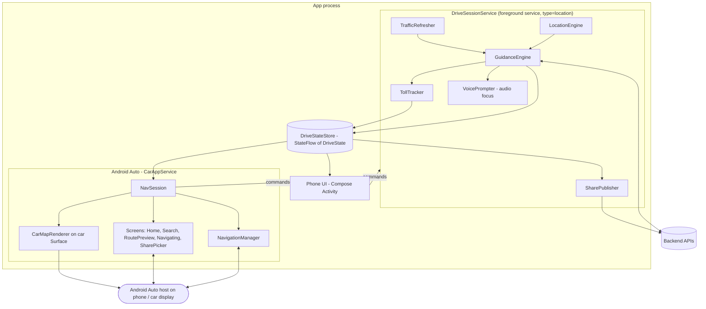
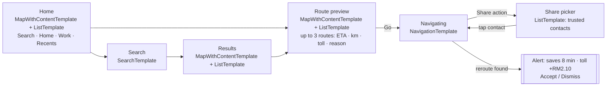

# 06 — Android App & Android Auto Design

Implements FR-08 (Android Auto), FR-21 (sharing controls in the car) and the Android platform decisions D8–D9.
Facts about Android APIs were checked on 24 Oct 2026 against developer.android.com. API names marked
`[VERIFY]` need confirming against the library version you actually use.

## 1. Platform decisions

| ID | Decision | Detail |
|---|---|---|
| D8 | **Android only**, native Kotlin | Jetpack Compose UI, Kotlin coroutines/Flow, Hilt DI, Room, DataStore, WorkManager. No iOS, no cross-platform framework. |
| D9 | **Android Auto via the Android for Cars App Library** (`androidx.car.app`) as a *navigation* category app | Templates are drawn by the car host; our app only supplies templates plus the map drawn on a car surface. |
| D9a | Android Automotive OS (cars with Android built in) is **out of scope for v1** | The same Car App Library code can later target it with the `app-automotive` artifact. |
| D9b | Phone and car are **two views of one drive session** | A single foreground service owns location, guidance, toll tracking and sharing; both UIs observe its state (§3). |

### 1.1 SDK and library versions (checked 24 Oct 2026)
| Item | Value | Notes |
|---|---|---|
| `androidx.car.app:app` + `app-projected` | **1.7.0** stable (Jul 2025). 1.8.0-rc01 (Aug 2026), 1.9.0-alpha03 (Oct 2026) | Start on 1.7.0; move to 1.8.0 when stable. 1.7.0 introduced `MapWithContentTemplate`. |
| Minimum Car App API level | **7** | Needed for `MapWithContentTemplate`. Older hosts: show a "please update Android Auto" message. |
| Car App API levels used later | 6+ for cluster display; 9 (alpha) adds `NavigationManager.setVoiceAssistantCapabilities` | Gate features with `carContext.carAppApiLevel`. |
| `compileSdk` / `targetSdk` | **37** (latest stable platform, checked 30 Oct 2026; set in `android/build-logic` `JalanzBuild`) | Play Store requires a recent target level. Re-check at each release. |
| `minSdk` | 28 (Android 9) `[ASSUMPTION]` | Check the minimum Android version the current Android Auto app supports, and Malaysian device share, before fixing this. |
| Map renderer | MapLibre Native Android / MapLibre Compose | See §5 for drawing on the car screen. |

## 2. Gradle module structure

```text
:app                      Phone app (Activity, Compose screens, navigation graph)
:car                      Android Auto: CarAppService, Session, Screens, car map renderer
:core:drive               DriveSessionService (foreground service) + DriveState store   <- single source of truth
:core:location            GNSS input, Kalman smoothing, map-matching to the route
:core:guidance            Route following, deviation detection, instruction generation, voice prompts (TTS)
:core:routing-client      Calls /v1/routes, parses Valhalla responses, reroute requests
:core:toll                Toll engine (pure Kotlin/JVM library, shared with the server — see 04 §1)
:core:share               Live-share publisher, E2E encryption, trusted contacts (see 07)
:core:map                 MapLibre styles (light/dark, BM/EN labels), camera logic shared by phone and car
:core:search-client       Search API client, offline FTS index
:core:data                Room DB (favourites, recents, contacts' share links, toll bundle), DataStore prefs
:core:privacy             Consent state, data export/delete, privacy dashboard model
:core:account             Optional sign-in (Firebase Auth: Google, Microsoft, email link), sync, key vault (08 §7)
:core:designsystem        Compose theme, BM/EN strings
:feature:search  :feature:route-preview  :feature:navigation  :feature:share  :feature:settings
```

Rule: `:car` and `:app` never talk to each other directly. Both depend on `:core:drive` and read the same
`StateFlow<DriveState>`.

## 3. Runtime architecture — one drive, two screens



### 3.1 `DriveState` (Kotlin, abridged)
```kotlin
sealed interface DriveState {
  data object Idle : DriveState
  data class Previewing(val routes: List<RouteOption>, val selected: Int) : DriveState
  data class Navigating(
    val route: Route,
    val progress: RouteProgress,          // distance/time remaining, current step, lanes
    val nextManeuver: Maneuver,
    val eta: Instant,
    val tollSoFarSen: Int,
    val tollRemainingSen: Int?,
    val trafficStatus: TrafficStatus,     // LIVE | STALE | NONE
    val rerouteOffer: RerouteOffer?,      // shown as Alert in the car
    val share: ShareStatus,               // from :core:share (07)
    val muted: Boolean,
  ) : DriveState
  data class Arrived(val destination: Place, val share: ShareStatus) : DriveState
}
```
Commands into the service: `StartPreview`, `SelectRoute`, `StartNavigation`, `AcceptReroute`, `StopNavigation`,
`ToggleMute`, `StartShare(recipients, precision, expiry)`, `StopShare`, `SetAvoidTolls`.

### 3.2 Lifecycle rules
| Situation | Behaviour |
|---|---|
| Navigation started on the phone, then phone connected to the car | Car `Session` reads `Navigating` state, pushes `NavigatingScreen`, calls `navigationStarted()` and `updateTrip()` immediately. |
| Navigation started in the car | Same service; phone shows the drive when opened. |
| Car disconnected mid-drive | Service keeps running; guidance continues on the phone (voice + notification). |
| Phone screen locked | Service continues; voice prompts keep playing; ongoing notification shows next turn. |
| Host calls `onStopNavigation` (user started another nav app) | Stop guidance, cluster updates and voice immediately. Live sharing **continues** if active (ETA then shows "not navigating"), and the ongoing notification offers "Stop sharing". |
| Arrival | `navigationEnded()`; sharing ends automatically 2 min after arrival (07 §6). |
| Process killed by system | On restart, do **not** resume silently; show "Your drive was interrupted — resume?" on phone and car. |

### 3.3 Foreground service & permissions
- `DriveSessionService`: `android:foregroundServiceType="location"`; permissions `FOREGROUND_SERVICE`,
  `FOREGROUND_SERVICE_LOCATION`, `ACCESS_FINE_LOCATION`, `ACCESS_COARSE_LOCATION`, `POST_NOTIFICATIONS`.
- Started **only as a direct result of a user action** (tap Go, tap Share, or a car action) — Play policy expects
  foreground-service location use to follow a user-initiated action and to end when that task ends.
- **Do not request `ACCESS_BACKGROUND_LOCATION` in v1.** Navigation and live sharing both run inside the
  user-started foreground service. Revisit only if a feature truly needs location while no drive is active
  (and then do Play's background-location declaration and prominent disclosure). `[VERIFY]` that starting the
  service from a car-app action counts as a foreground start on your target Android versions.
- Ongoing notification (always visible while the service runs): next turn, ETA, and — if sharing — "Sharing with
  N people · Stop sharing".

## 4. Android Auto UX

### 4.1 Screen map (Car App Library templates)



Task-length rule: every flow above is ≤ 4 steps (Home → Search → Results → Preview → Go). Favourites reach
navigation in 2 steps (Home → Preview → Go). Google's guidelines require ≤ 5 steps and recommend 2–3.

### 4.2 Screen specifications
| Screen | Template | Content | Actions |
|---|---|---|---|
| Home | `MapWithContentTemplate` + `ListTemplate` | Rows: Home, Work, up to 4 recents/favourites (each with ETA if cheap to compute) | Action strip: Search, Share (only when a share is active — shows status) |
| Search | `SearchTemplate` | Host keyboard (host disables typing while driving; voice via host) | Results pushed as list |
| Results | `MapWithContentTemplate` + `ListTemplate` | ≤ 6 rows: name, distance, area | Tap → Route preview |
| Route preview | `MapWithContentTemplate` + `ListTemplate` + `MapController` | One row per route: "32 min · 24 km · Toll RM3.40" + reason ("Fastest", "No tolls, +6 min") | Go; action strip toggle "Avoid tolls" |
| Navigating | `NavigationTemplate` | `RoutingInfo` (current step, maneuver icon, lanes, distance to turn); `TravelEstimate` (ETA, remaining distance/time; `tripText` = "Toll RM15.25" or "Sharing with 2") | Action strip: **Share**, Mute, Stop. Map action strip: Recentre, Zoom in/out, Pan |
| Share picker | `ListTemplate` | ≤ 6 trusted contacts + "Everyone in auto-share list"; active ones marked | Tap toggles a recipient and returns to Navigating; row "Stop sharing" when active |
| Reroute offer | `Alert` on `NavigationTemplate` | "Faster route: saves 8 min · toll +RM2.10" | Accept / Dismiss; auto-dismiss after 10 s (recommended duration) |
| Unsupported host | `MessageTemplate` | "Update Android Auto to use this app" | — |

Text and visual rules (Android Auto navigation quality guidelines):
- Draw only map and driving-related content on the map surface; meet contrast requirements.
- Text drawn on the map ≥ 24 dp unless attached to a road/route; icons and markers ≥ 36 × 36 dp.
- Draw a dark map when `CarContext.isDarkMode` is true; react to `onCarConfigurationChanged`.
- Clearly indicate when an action will change the route.
- Never show free-text input, long text, toll breakdown tables or settings in the car — those stay on the phone.

### 4.3 Navigation data to the host
- `NavigationManager.navigationStarted()` when guidance starts; `navigationEnded()` only on arrival or cancel.
  During a reroute, keep the trip and call `updateTrip()` with `Trip.Builder.setLoading(true)` instead.
- `updateTrip(Trip)` on every guidance tick (≈1 s) with `Step` (maneuver type, lanes, road name cue),
  `TravelEstimate` and `Destination`. The host uses this for the cluster and heads-up displays.
- Turn-by-turn notifications when the user leaves `NavigationTemplate` (e.g., opens another car app):
  `setOngoing(true)`, `CATEGORY_NAVIGATION`, `CarAppExtender`; `IMPORTANCE_HIGH` with `setOnlyAlertOnce(true)`
  only for an upcoming manoeuvre.
- Voice guidance: request audio focus with `USAGE_ASSISTANCE_NAVIGATION_GUIDANCE` and
  `AUDIOFOCUS_GAIN_TRANSIENT_MAY_DUCK`; release after each prompt. BM and EN prompts via Android
  `TextToSpeech` (`ms-MY`, `en-MY`/`en-GB`) `[VERIFY]` BM voice availability on common Malaysian phones; ship a
  fallback (pre-recorded BM prompts for the ~40 standard phrases) if quality is poor.
- Implement `NavigationManagerCallback.onStopNavigation` (stop everything guidance-related at once) and
  `onAutoDriveEnabled` (simulated drive for Play review; test with
  `adb shell dumpsys activity service <CAR_APP_SERVICE> AUTO_DRIVE`).

### 4.4 Intents and voice
- Handle navigation intents in both `Session.onCreateScreen()` and `Session.onNewIntent()` (required for
  navigation apps by the quality guideline referenced as NF-6). Accept `geo:` coordinates and `geo:0,0?q=` queries
  `[VERIFY]` exact intent action/URI forms in the navigation-intents reference.
- When our app is the default navigation app, Google Assistant navigation requests ("navigate to Mid Valley")
  arrive as these intents.
- Backlog (10 §13): adopt `NavigationVoiceAssistantCapabilities` (Car App API 9) once stable.

### 4.5 Instrument cluster (Phase 7, see 10 §11)
- Declare `androidx.car.app.category.FEATURE_CLUSTER`; create a separate cluster `Session` when
  `SessionInfo.displayType == DISPLAY_TYPE_CLUSTER`; only `NavigationTemplate` with map tiles and route.
- Draw an idle map until `navigationStarted()` grants control. Cluster and main sessions share state through
  `DriveStateStore` (each session has its own `CarContext`).

## 5. Drawing the map on the car screen

Manifest: `androidx.car.app.NAVIGATION_TEMPLATES`, `androidx.car.app.ACCESS_SURFACE`; service intent filter with
`androidx.car.app.CarAppService` + category `androidx.car.app.category.NAVIGATION`.

Register a `SurfaceCallback` with `AppManager.setSurfaceCallback()`:
- `onSurfaceAvailable(SurfaceContainer)` → attach the map renderer to `surfaceContainer.surface` with its width,
  height and dpi.
- `onVisibleAreaChanged(Rect)` / `onStableAreaChanged(Rect)` → set map camera padding so the car icon and next
  turn are never hidden behind templates.
- `onSurfaceDestroyed()` → detach and release.
- Gestures (`onScroll`, `onScale`, `onFling`, `onClick`) → forward to the map camera `[VERIFY]` API level per callback.

Renderer options (pick in Phase 0 spike):
| Option | How | Notes |
|---|---|---|
| A (preferred) | **MapLibre Compose `AndroidMapPresentation`** — `attachSurface(surface, width, height, density)` → binding; `binding.update()` on resize; `binding.close()` on destroy; main thread only | Built for surfaces "such as one supplied by Android Auto"; demo in `demo-app/android-auto` `[VERIFY]` maturity |
| B (fallback) | `VirtualDisplay` on the car surface + `Presentation` hosting a MapLibre `MapView` | Pattern documented on developer.android.com "Draw maps" |

Map styling: shared `:core:map` style with light/dark variants, larger road labels and route casing for car
contrast, toll roads tinted, toll plazas as ≥ 36 dp markers. Frame rate: cap at 30 fps when following,
`[ASSUMPTION]` tune for battery and head-unit performance.

## 6. Guidance engine choice
| Option | Pros | Cons |
|---|---|---|
| **Ferrostar** core (BSD licence; MapLibre-based UI; Jetpack Compose components) | Open source, built for OSM/MapLibre stacks, works with Valhalla-style route responses `[VERIFY]` | Android Auto integration status not confirmed — budget to build the car layer ourselves |
| Own engine in `:core:guidance` | Full control over BM instructions and toll-aware prompts | More work: snapping, deviation, instruction timing |

Recommendation: Phase 0 spike with Ferrostar core + our own `:car` layer; fall back to an own engine if the
spike fails. Either way the car UI only consumes `DriveState`.

## 7. Testing & release
- **Desktop Head Unit (DHU)** for all car screens; test day/night, small and wide screens, touch and rotary input.
- `androidx.car.app:app-testing` for screen/template unit tests (`TestCarContext`, `ScreenController`).
- Simulated drives via `onAutoDriveEnabled` and recorded GPX traces of Malaysian routes (KL urban, PLUS, LPT,
  Penang Bridge) replayed through `LocationEngine`.
- Real car tests on at least two head units (one wired, one wireless Android Auto).
- Play Store: navigation-category car apps go through Android Auto quality review; ship via internal → closed
  testing tracks. For sideloaded debug builds, enable "Unknown sources" in Android Auto developer settings.

## 8. Car-related acceptance tests
| ID | Test | Pass condition |
|---|---|---|
| AA-01 | Start on phone, connect to DHU | Car shows active navigation within 2 s, same ETA as phone |
| AA-02 | Start from car Home favourite | ≤ 2 taps to Go |
| AA-03 | Route preview | Every route row shows ETA, distance and toll (or "Toll unknown") |
| AA-04 | Reroute | Alert appears with time and toll difference; Accept changes route; Dismiss keeps route |
| AA-05 | Another nav app started | Our voice and cluster updates stop within 1 s (`onStopNavigation`) |
| AA-06 | Night mode | Dark map within 1 s of host switching |
| AA-07 | Share from car | Start sharing with a trusted contact in ≤ 2 taps from Navigating; `tripText` shows "Sharing with 1" |
| AA-08 | Disconnect car | Phone continues voice guidance without interruption |
| AA-09 | Old host (API < 7) | Shows update message, no crash |
| AA-10 | Text/marker sizes | Map text ≥ 24 dp, markers ≥ 36 dp (screenshot audit) |
