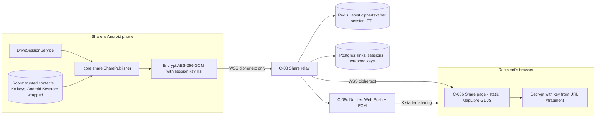
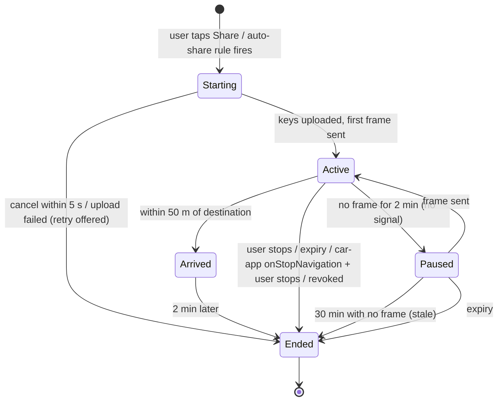

# 07 — Live Location Sharing While Driving

Implements FR-07 and FR-20 to FR-25, NFR-11 and NFR-12. Owner components: `:core:share` (C-01h), Share relay (C-08),
share web page (C-08b). Android and Android Auto integration is in `06-android-auto.md`.

## 1. Goals
1. Let a driver show trusted people where they are and when they will arrive, **without typing or looking at the
   phone while driving**.
2. Recipients need **no app**: a link opens a live map in any mobile browser. Malaysians mostly share via WhatsApp,
   so the link is designed to be sent once and reused.
3. **The server never sees the location.** Updates are end-to-end encrypted between the sharer's phone and the
   viewer's browser.
4. Safe by default: sharing is always visible, always ends, and can't be switched on by anyone but the driver.

## 2. Concepts
| Term | Meaning |
|---|---|
| **Share session** | One period of live sharing, usually one trip. Has a start, an expiry and a set of recipients. |
| **Trusted contact** | A person the driver set up beforehand: a display label ("Mum") + a **standing link**. No phone number or contacts permission needed. |
| **Standing link** | A permanent personal link for one trusted contact (`/c/{link_id}#k=...`). Sent once (e.g., via WhatsApp). It shows "Not sharing right now" until the driver starts a session that includes this contact; then it goes live. |
| **One-off link** | A link for a single session (`/s/{share_id}#k=...`), shared through the Android share sheet before driving. |
| **Auto-share rule** | Driver-created rule: "When I navigate to *Home*, share with *Mum*" or "Share every drive longer than 30 min with *Wife*". |
| **Precision** | `exact`, `approximate` (rounded to ~1 km, no speed/heading) or `eta_only` (no position). |

## 3. User flows

### 3.1 Set up a trusted contact (phone, parked) — once
1. Settings → Sharing → Add trusted contact → type a label.
2. The app generates `link_id` (server) and contact key `K_c` (on device; never sent to the server).
3. The app opens the Android share sheet with a short BM/EN message + the standing link → user picks WhatsApp.
4. Optional: the recipient opens the link and taps "Notify me when they start sharing" (Web Push, §7.2).

### 3.2 Start sharing before driving (phone)
- Route preview → "Share trip" → pick trusted contacts and/or "Get a link" (one-off, opens share sheet) →
  choose precision (default `exact`) and expiry (default: arrival + 2 min, max 12 h) → Go.

### 3.3 Start sharing while driving (Android Auto) — ≤ 2 taps
- Navigating screen → **Share** action → Share picker (≤ 6 trusted contacts) → tap a contact → back to navigation.
- `TravelEstimate.tripText` shows "Sharing with 1"; the action becomes "Sharing" (tap → picker with "Stop sharing").
- No typing, no link creation, no share sheet in the car: one-off links are phone-only because they need the
  driver to send the link.

### 3.4 Start sharing while driving (phone only, no car)
- The ongoing navigation notification and the navigation screen have a **Share** action → a full-screen picker
  with large buttons (same ≤ 6 contacts). One tap per contact, no text entry, no share sheet (NFR-03).
  One-off links ("Get a link") are hidden while the vehicle is moving faster than 10 km/h.

### 3.5 Automatic sharing
- Auto-share rules start a session when navigation starts to a matching destination (or matching trip length).
- The driver is told by voice and on screen: "Sharing your trip with Mum" with a 5-second "Cancel" in the car
  (`Alert`) and on the phone notification.

### 3.6 Stop sharing
- Car: Share picker → "Stop sharing". Phone: notification action "Stop sharing". Automatic: arrival + 2 min, expiry,
  or the drive ends with no destination (stopped for 15 min and app closed — asks first on the phone).

## 4. Architecture



### 4.1 Encryption design (NFR-12)
- **One-off link:** device creates session key `Ks` (256-bit). Link = `https://<share-domain>/s/{share_id}#k={b64url(Ks)}`.
  The `#fragment` is never sent to the server by browsers.
- **Standing link:** device creates contact key `Kc` once. Link = `https://<share-domain>/c/{link_id}#k={b64url(Kc)}`.
  For each session that includes the contact, the device uploads `wrap = AES-GCM(Kc, Ks)` for that `link_id`.
  The viewer page fetches the wrap for the active session, unwraps `Ks` with `Kc`, then decrypts updates.
- **Update frame:** `{session_id, seq, nonce, ciphertext}`; plaintext is the JSON in §5. AAD = `session_id || seq`
  to stop replay/reordering. Keys rotate per session.
- **Revoking a contact:** delete `link_id` server-side (link dies immediately); the contact needs a new link.
- **Honest limitation:** the share page's JavaScript is served by us, so a compromised server could serve a bad
  page. Mitigate with a static, versioned page, Subresource Integrity on all scripts, a published page hash, and
  open-sourcing the page.
- Keys at rest on the phone: stored in Room encrypted with an Android Keystore key.

### 4.2 Server data (no plaintext location anywhere)
```sql
CREATE TABLE share_link (            -- one per trusted contact
  link_id       TEXT PRIMARY KEY,     -- ≥128-bit random, base64url
  owner_token   TEXT NOT NULL,        -- hash of the device token
  created_at    TIMESTAMPTZ NOT NULL,
  revoked_at    TIMESTAMPTZ
);
CREATE TABLE share_session (
  share_id      TEXT PRIMARY KEY,     -- ≥128-bit random
  owner_token   TEXT NOT NULL,
  publish_token_hash TEXT NOT NULL,
  started_at    TIMESTAMPTZ NOT NULL,
  expires_at    TIMESTAMPTZ NOT NULL, -- hard cap 12 h after start
  ended_at      TIMESTAMPTZ,
  end_reason    TEXT                  -- arrived | user_stopped | expired | revoked | interrupted
);
CREATE TABLE share_session_key (     -- wrapped Ks per standing link
  share_id      TEXT REFERENCES share_session ON DELETE CASCADE,
  link_id       TEXT REFERENCES share_link ON DELETE CASCADE,
  wrapped_key   BYTEA NOT NULL,
  PRIMARY KEY (share_id, link_id)
);
CREATE TABLE webpush_subscription (
  link_id       TEXT REFERENCES share_link ON DELETE CASCADE,
  endpoint      TEXT NOT NULL, p256dh TEXT NOT NULL, auth TEXT NOT NULL,
  created_at    TIMESTAMPTZ NOT NULL
);
```
- Redis keeps only the **latest** ciphertext frame per session (`TTL = expires_at`), so late viewers see the
  current position. No history is stored.
- Session rows are deleted 24 h after `ended_at`; only aggregate counts are kept for metrics.

## 5. Update payload and cadence

Plaintext (before encryption):
```json
{
  "v": 1,
  "t": "2026-10-24T08:15:30+08:00",
  "state": "driving",
  "sharer_name": "Aiman",
  "pos": { "lat": 3.1179, "lon": 101.6773, "acc_m": 8 },
  "heading": 132,
  "speed_kph": 64,
  "eta": "2026-10-24T08:42:00+08:00",
  "eta_delta_min": 4,
  "dest_label": "Home",
  "route": "polyline6-encoded remaining route (optional)",
  "battery_low": false
}
```
- `state`: `driving` | `stopped` | `arrived` | `not_navigating` | `paused`.
- `approximate`: `pos` rounded to a ~1 km grid, `acc_m` set to 1000, no `speed_kph`, `heading`, `route`.
- `eta_only`: no `pos`, `heading`, `speed_kph`, `route`.
- `dest_label` and `route` are included only if the driver allowed them for this session (default: label yes,
  route no).

Cadence (reuses the navigation location stream — no extra GPS use):
| Condition | Send when |
|---|---|
| Moving | ≥ 10 s since last **and** ≥ 50 m moved, or 30 s heartbeat |
| Stopped (< 5 km/h) | every 60 s |
| ETA changes ≥ 2 min | immediately |
| No network | keep only the newest frame; send on reconnect (never a backlog) |
| Battery saver on | moving: ≥ 20 s / 100 m |

### 5.1 Privacy zones (on device)
- The phone keeps privacy zones: a ~500 m circle around the **trip start point** and around saved **Home** and
  **Work** (user can add more). Zone locations are **never sent** to the server or recipients.
- While the car is inside a zone, frames carry `state` and `eta` but **no `pos`, `heading`, `speed_kph` or `route`**;
  the viewer shows "Position hidden near a private place".
- Applies to every precision level and to the trip log (FR-19). Adopted from Peta Maps (12 §2.1).

## 6. Session state machine


Viewer sees: "Live" (frame < 60 s old), "Last updated 4 min ago" (Paused), "Arrived at Home 8:42",
"Sharing ended".

## 7. Recipient experience

### 7.1 Share page (C-08b)
- Static page + MapLibre GL JS using our tiles; BM/EN toggle; works on low-end phones and slow data.
- Shows: driver's label, car marker (or ETA card for `eta_only`), ETA and "arriving in 12 min", last updated
  time, destination label if allowed, status badges (Stopped, Arrived, Signal lost).
- No ads, no third-party analytics, `noindex`, no cookies beyond what the page needs.
- One-way only: viewers cannot message, "ping" or request location.

### 7.2 Notifications to recipients
| Event | Message (EN; BM equivalent shipped) | Channel |
|---|---|---|
| Session started (standing link) | "Aiman is now sharing his drive · ETA 8:42 pm" (the sharer's display name, set in the app; example name) | Web Push (if recipient opted in on the page); FCM if the recipient also has the app |
| ETA later by ≥ 10 min than first ETA | "Running about 15 min late · new ETA 8:57 pm" | Same |
| Arrived | "Arrived at Home" | Same |
| Signal lost > 5 min | Not pushed (avoids alarming people); shown on page only | — |

- The server must not learn names or ETAs, so push messages carry only `link_id` + event type. The share page's
  service worker (or the recipient's app) builds the text locally from the sharer's display name and latest ETA,
  which it decrypted and cached the last time the viewer opened the link. The display name travels only inside
  encrypted frames (`sharer_name` field in §5). If nothing is cached yet, the text is generic: "A drive you
  follow has started — tap to view".
- **No SMS or WhatsApp sending by the app.** Google Play restricts SMS permissions to default SMS apps and a few
  exceptions `[VERIFY]`, and automated WhatsApp messages need the WhatsApp Business Platform. The standing-link
  design avoids both: the link is sent once by the driver, by hand, when parked.
- Web Push on iPhones generally requires the page to be added to the home screen `[VERIFY]`; the page explains
  this to iPhone viewers. (The *app* is Android-only; *viewers* can use any phone.)

## 8. Safety and abuse prevention (FR-25)
1. Sharing **only** starts from the driver's own action or a rule they created on an unlocked phone.
2. Always visible while active: Android ongoing notification ("Sharing location with Mum, Ali · Stop") and the
   car's `tripText`. These cannot be hidden in settings.
3. Every session ends: arrival + 2 min, chosen expiry, 30 min without any update (stale), or hard cap of 12 h.
4. Auto-share rules are listed in Settings with a once-a-month reminder: "You auto-share drives with: Mum. Keep?".
5. Starting an auto-share session is announced by voice and can be cancelled within 5 s.
6. No remote control: nobody can start, extend or locate the driver from outside.
7. Viewers are anonymous to us, and the driver sees how many viewers are connected right now (count only).
8. "Stop all sharing" in the privacy dashboard revokes all sessions and, optionally, all standing links.
9. No contacts, SMS or background-location permissions are requested for sharing.

## 9. Android and Android Auto integration (see 06)
- `:core:share` runs inside `DriveSessionService` (06 §3); the service's location type covers sharing.
- If sharing starts with no navigation ("just share while I drive"), the same service starts in `not_navigating`
  mode; ETA is omitted unless a destination is set.
- Car: Share action on `NavigationTemplate`; Share picker is a `ListTemplate` with ≤ 6 rows; status in `tripText`;
  auto-share confirmation as an `Alert` with a Cancel action (10 s).
- If the host calls `onStopNavigation`, sharing continues with `state = not_navigating` and the phone
  notification asks "Keep sharing?".

## 10. API (share relay, C-08)
| Method & path | Purpose | Auth |
|---|---|---|
| `POST /v1/share/links` | Create a standing link → `{link_id}` (key `Kc` made on device) | Device token |
| `DELETE /v1/share/links/{link_id}` | Revoke a standing link | Device token |
| `POST /v1/share/sessions` `{expires_at, precision}` | Start session → `{share_id, publish_token}` | Device token |
| `PUT /v1/share/sessions/{share_id}/keys` `{link_id: wrapped_key}` | Add/remove recipients mid-session | Publish token |
| `WS /v1/share/sessions/{share_id}/publish` | Send encrypted frames | Publish token |
| `DELETE /v1/share/sessions/{share_id}` | End session | Publish token |
| `GET /s/{share_id}` · `GET /c/{link_id}` | Share page (static) | None (unguessable ID) |
| `GET /v1/share/view/{id}` | Current session + wrapped key (standing link) or session status (one-off) | None |
| `WS /v1/share/view/{id}` | Receive frames | None |
| `POST /v1/share/links/{link_id}/webpush` | Viewer opts in to notifications | None |

Rate limits: 1 frame/2 s per session; 20 sessions/day per device; viewers per session capped at 50.

## 11. Acceptance tests
| ID | Test | Pass condition |
|---|---|---|
| SH-01 | Server data audit | No plaintext coordinates in DB, Redis, logs or metrics (automated scan) |
| SH-02 | Standing link idle | Opening shows "Not sharing right now" |
| SH-03 | Start from Android Auto | ≤ 2 taps; viewer sees live position within 10 s |
| SH-04 | Update latency | Phone → viewer ≤ 10 s p95 on 4G |
| SH-05 | Arrival | Viewer sees "Arrived" and session ends ≤ 2 min 30 s after arrival |
| SH-06 | Revoke contact mid-session | That viewer loses access within 10 s; others unaffected |
| SH-07 | Precision `approximate` | Viewer position error ≥ 500 m from true; no speed/heading in payload |
| SH-08 | No signal for 3 min, then reconnect | Viewer shows "Last updated…", then only the newest frame arrives (no backlog) |
| SH-09 | Auto-share rule | Voice + Alert announce; Cancel within 5 s stops before first frame is sent |
| SH-10 | Hard cap | Session ends at 12 h even if not arrived |
| SH-11 | Tampered frame | Viewer rejects frame (GCM auth failure), keeps last good position |
| SH-12 | Battery | Sharing adds ≤ 1 % per hour on top of navigation (NFR-04 device lab) |
