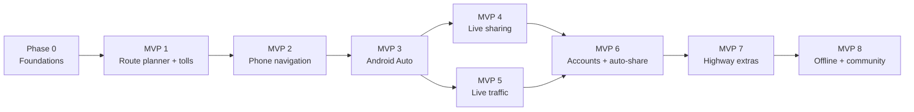

# 10 — Build Phases & MVPs

How to build the app **incrementally with AI coding agents**. Each phase ends in a working, installable **MVP**
released to the 10 testers on the Play internal testing track (except Phase 0). Each phase is split into
**work packages (WPs)**. One WP = one branch (09 §4) = one focused AI session or a few.

This file replaces the roadmap sketch in 03 §11. **During the testing period, apply the overrides in
`11-zero-cost-testing.md` §2** (free distribution instead of Play, DuckDNS instead of a paid domain).

## 1. Rules for building in phases

**Coverage: Peninsular Malaysia only** (confirmed 29 Oct 2026). Clip map tiles, routing graph, place index, search
test list and toll plazas to Peninsular Malaysia. This also lowers server memory needs. Sabah and Sarawak become a
later expansion (§13).


1. Build phases **in order**. Phases 4 and 5 may run in parallel once Phase 3 is merged (they touch different
   modules), but everything else is sequential.
2. Inside a phase, build WPs in the listed order unless "Depends on" says otherwise.
3. Do **not** build anything listed under a phase's "Not in this phase". If a WP seems to need it, stub it behind
   an interface and note it in the commit body.
4. A phase is finished only when its **exit criteria** pass. Then cut `release/0.N.0` (09 §8.1–8.2).
5. Every WP is done when: code and tests are written, the checks in 09 §7.1 pass, spec files are updated if
   behaviour changed, commits follow 09 §6, and the branch is merged into `develop` via the 09 §8 checklist.
6. If the spec is ambiguous or a `[VERIFY]` item blocks progress, stop and ask the product owner instead of guessing.

Sizes: **S** = one session, **M** = two to three sessions, **L** = more than three (consider splitting).

### 1.1 Personal-use track (product owner, 30 Oct 2026)

For now Jalanz is built **for the product owner's own use only**. Until that changes, the app calls free public
services directly instead of our own server stack, so no Docker or server is needed:

| Need | Public service (05 §1) | Replaces, for now |
|---|---|---|
| Base map | OpenFreeMap tiles (DS-15) | WP 0.7 PMTiles, WP 1.14 tiles from our server |
| Place search | Photon by komoot (DS-16) | WP 0.8, WP 1.11 Typesense + `GET /v1/search` |
| Routing | Valhalla on the FOSSGIS server (DS-17), incl. `trace_attributes` way IDs | WP 0.6, WP 1.12 `POST /v1/routes` |
| Toll estimate | On-device `:core:toll` | WP 1.10 `POST /v1/toll/estimate` |
| Toll dataset | Crawled on the developer's PC (WP 1.7) and bundled into the local build; never committed | WP 1.9 server bundle download |

Rules for this track:
- **Build order:** WP 1.1–1.5 (toll engine), then map (1.14), search (1.15), route preview (1.16) against the
  public services, then the toll crawler and plaza mapping (1.7, 1.8). WP 2.9 (share-in) was pulled forward on 30 Oct 2026, with
  long-press pins and named saved places, because many small shops are in neither OSM nor Overture.
- **WP 1.16 on this track (30 Oct 2026):** route cards show "Tolls (amount not loaded yet)" / "No tolls" from
  Valhalla's `has_toll`, never a guessed amount. The vehicle class picker and the toll breakdown sheet are deferred
  until real toll rates exist (WP 1.7–1.9); routes start from Home or a picked place until the drive service
  (WP 2.1) provides the phone's position. WP 0.4–0.8, 1.6, 1.9–1.13, 1.17 and 1.18 are
  **deferred**, not dropped. Phase 2 can follow; Phase 4 (sharing) needs a relay server, so revisit hosting then.
- **Keep the seams:** call each service through an interface in `:core:routing-client`, `:core:search-client` and
  `:core:map`, so switching to our own server later is a new implementation, not a rewrite.
- **Privacy trade-off (accepted for personal use only):** search text and route start/end points, plus the phone's
  IP address, go to komoot and FOSSGIS. This breaks the NFR-13 promise for other users, so **before anyone else
  installs Jalanz** the deferred server WPs must be built, or the product owner must decide again.
- **Fair use:** one user fits the public services' policies; 10 testers may not. Send a descriptive User-Agent, cache
  results, and never add load tests against them.
- No API keys and no cost. Anything that needs a key (e.g. TomTom traffic) still needs product-owner approval.

## 2. Phase overview

| Phase | MVP (what testers can do) | Version | Main requirements |
|---|---|---|---|
| 0 | Nothing for testers yet. Repo, CI, server and risky technology proven | 0.0.x (internal) | NFR-02, NFR-11 baseline |
| 1 | **Route planner with tolls**: search, see up to 3 routes with time, distance and exact toll, avoid tolls | 0.1.0 | FR-01, FR-05, FR-06, FR-09 |
| 2 | **Turn-by-turn on the phone**: BM/EN voice, lanes, reroute when off route, toll so far | 0.2.0 | FR-03, FR-16, FR-17, FR-18 (basic) |
| 3 | **Android Auto**: the same drive on the car screen | 0.3.0 | FR-08 |
| 4 | **Live sharing while driving**: trusted contacts, from phone or car, encrypted | 0.4.0 | FR-07, FR-20, FR-21, FR-24, FR-25 |
| 5 | **Live traffic & plan ahead**: traffic-aware ETAs, explained reroutes, future tolls | 0.5.0 | FR-04, FR-05 (reasons), FR-15 (departure time), NFR-06 |
| 6 | **Accounts & smarter sharing**: optional sign-in and sync, auto-share, recipient notifications | 0.6.0 | FR-26, FR-22, FR-23, FR-18 (full) |
| 7 | **Highway extras & profiles**: R&R/fuel/EV, motorcycle and other profiles, simple mode, multi-stop, toll log, cluster | 0.7.0 | FR-02, FR-12, FR-13, FR-14, FR-15 (multi-stop), FR-19 |
| 8 | **Offline & community**: offline regions, crowd reports | 0.8.0 | FR-10, FR-11 |



Why this order: Phase 1 delivers the app's unique value (tolls nobody else shows) with the least risk.
Navigation (2) must exist before the car (3), and the car before in-car sharing controls (4). Traffic (5) needs
navigation and costs money if overused, so it comes after the core works. Accounts (6) are optional by design, so
they wait until there is something worth syncing.

## 3. Requirement → phase matrix

| Req | Phase | Notes |
|---|---|---|
| FR-01 Search | 1 | Search gate ≥ 90 % (03 §5.3) |
| FR-02 Missing-place flow | 7 | |
| FR-03 Voice guidance, lanes | 2 | |
| FR-04 Live traffic | 5 | Phases 1–4 route on typical speeds and say "no live traffic" |
| FR-05 Alternatives + toll + avoid tolls | 1 | Reroute reason text in 5 |
| FR-06 Toll estimate | 1 | All fixtures F1–F10 in 1; freshness monitoring in 5 |
| FR-07 Live sharing | 4 | |
| FR-08 Android Auto | 3 | Instrument cluster in 7 |
| FR-09 No account needed | 1 → all | Re-tested every phase (AC-01 in 6) |
| FR-10 Offline | 8 | Offline toll bundle already from 1 |
| FR-11 Crowd reports | 8 | |
| FR-12 R&R, fuel, EV | 7 | |
| FR-13 Vehicle profiles | 1 (toll class only), 7 (routing profiles, rider mode) | |
| FR-14 Simple mode | 7 | |
| FR-15 Plan ahead | 5 (departure time), 7 (multi-stop) | |
| FR-16 Onboarding | 2 | |
| FR-17 Share-in (`geo:` etc.) | 2 | |
| FR-18 Privacy dashboard | 2 (basic), 4 (stop all sharing), 6 (export, delete account) | |
| FR-19 Trip toll log | 7 | |
| FR-20 Trusted contacts | 4 | |
| FR-21 Share controls phone/car | 4 | |
| FR-22 Auto-share rules | 6 | |
| FR-23 Recipient notifications | 6 | |
| FR-24 Share precision | 4 | |
| FR-25 Sharing safeguards | 4 | |
| FR-26 Optional accounts | 6 | |
| FR-27 Driving-safety extras | 7 | |
| NFR-01 Accuracy | 2 | |
| NFR-02 Privacy, Malaysian hosting | 0 → all | DPIA before any public launch (§11) |
| NFR-03 Distraction limits | 2, 3 | |
| NFR-04 Battery/data | 2 (navigation), 4 (sharing, SH-12) | |
| NFR-05 Degradation | 1 (toll bundle fallback), 5 (traffic) | |
| NFR-06 Toll freshness | 1 (dataset date shown), 5 (SLOs) | |
| NFR-07 Transparency | 2 | Provider list page |
| NFR-08 Usability | 3 | SUS with the 10 testers; 15-driver study before public launch |
| NFR-09 BM/EN | 1 (UI), 2 (voice) | |
| NFR-10 Attribution | 1 | |
| NFR-11 Platform | 0 | |
| NFR-12 Share encryption | 4 | |
| NFR-13 Request privacy | 1 | Applies from the first search/route API |

## 4. Phase 0 — Foundations & spikes (internal, no MVP)

**Goal:** a working repo, CI and server, and decisions on every risky technology before feature work.

| WP | Branch | Size | Scope | Done when |
|---|---|---|---|---|
| 0.1 | `chore/misc-monorepo-skeleton` | S | Folders per 09 §2, `.gitignore`, `.gitmessage`, `.githooks/commit-msg`, root README | Hook rejects a bad message locally |
| 0.2 | `build/misc-ci-pipeline` | S | GitHub Actions: Gradle test + lint, pytest, web lint, commit-message check on every commit | CI green on an empty build |
| 0.3 | `build/NFR-11-android-skeleton` | M | Gradle modules from 06 §2 (empty), version catalog, Compose app shell, Hilt, minSdk/targetSdk | App installs and shows a placeholder screen |
| 0.4 | `build/misc-backend-skeleton` | S | Ktor app with `/health`, arm64 Docker image | `/health` returns 200 in a container |
| 0.5 | `build/NFR-02-infra-compose` | M | Docker Compose stack **running locally on the developer's PC**: Caddy, api, Postgres/PostGIS, Valkey (Valhalla, tiles and search added by later WPs). Same Compose file must later run unchanged on the test server (WP 1.18). Debug app builds reach it over home Wi-Fi (debug-only cleartext/network-security config for the PC's LAN address; release builds HTTPS only) | `curl http://<pc-lan-ip>/health` returns 200 from a phone on the same Wi-Fi |
| 0.6 | `spike/C-03-valhalla-peninsular` | M | Build Valhalla tiles for **Peninsular Malaysia** (clip the Geofabrik Malaysia/Singapore/Brunei extract) on the local PC; route KL→Penang; measure RAM, disk and build time; check the image also exists for arm64 in case the test server is Arm | Numbers recorded; routes work locally |
| 0.7 | `spike/C-05-pmtiles-malaysia` | S | Planetiler PMTiles build; light/dark MapLibre style with BM/EN labels | Map renders on a phone from our server |
| 0.8 | `spike/FR-01-overture-poi-coverage` | M | Write `fixtures/search_test_list.csv` (≥ 300 Malaysian queries); DuckDB extract of Overture places; Typesense index; measure top-3 hit rate | Hit rate measured; gap list written |
| 0.9 | `spike/FR-06-osm-toll-plaza-audit` | M | Compare OSM `barrier=toll_booth`/`highway=toll_gantry` nodes with LLM portal plaza list | % matched per highway recorded |
| 0.10 | `spike/C-01-car-surface-renderer` | M | MapLibre Compose `AndroidMapPresentation` vs VirtualDisplay+`Presentation` on the DHU (06 §5) | Renderer chosen |
| 0.11 | `spike/C-01-guidance-engine` | M | Ferrostar core vs own engine with a Valhalla route (06 §6) | Engine chosen |
| 0.12 | `spike/NFR-09-bm-tts` | S | Android TTS `ms-MY` quality on 3 common Malaysian phones | Decide: TTS only, or pre-recorded BM fallback |
| 0.13 | `docs/misc-phase0-decisions` | S | Write spike results into 06 §5–6, 08 §6, 03 §5.3; remove resolved `[VERIFY]` tags | Spec updated and merged |

**Exit criteria:** CI green; local Compose stack `/health` reachable from a phone on the same Wi-Fi; every spike has a recorded decision; search hit
rate baseline known.

**Not in this phase:** any user-facing feature.

## 5. Phase 1 — MVP 1: Route planner with tolls (v0.1.0)

**Testers can:** search for two places, see up to 3 routes with time, distance and toll in RM for their vehicle
class, switch on "avoid tolls", open a per-plaza toll breakdown with "rates as of" date and confidence. No sign-in.

| WP | Branch | Size | Scope | Spec | Depends on |
|---|---|---|---|---|---|
| 1.1 | `feature/FR-06-toll-domain-model` | M | `:core:toll` pure-Kotlin models, integer sen, effective-date selection | 04 §1, §3, §6 | 0.3 |
| 1.2 | `test/F1-F10-toll-fixtures` | M | Fixture JSON F1–F10 + runner (test-first commits allowed, 09 §5.3) | 04 §9 | 1.1 |
| 1.3 | `feature/FR-06-plaza-detection` | M | Way-aware crossing detection + geometric fallback (F6, F9) | 04 §5 | 1.1 |
| 1.4 | `feature/FR-06-open-and-closed-fares` | M | Open fares, closed entry/exit pairing, toggles, multiple networks (F1, F3, F4, F7, F8) | 04 §6 | 1.3 |
| 1.5 | `feature/FR-06-discounts-and-confidence` | M | Discount events with exclusions and rounding (F2a–d); LOW ranges, MEDIUM rules (F5, F10) | 04 §6–6.1 | 1.4 |
| 1.6 | `feature/FR-06-toll-db-schema` | S | Postgres DDL from 04 §3 **plus indexes**: fare lookup indexes on (network, entry, exit, class, effective_from) and (plaza, class, effective_from); GiST on `plaza.geom`; exclusion constraint so effective periods for the same fare key never overlap | 04 §3 | 0.5 |
| 1.7 | `feature/FR-06-llm-portal-crawler` | L | Python: crawl LLM portal politely, raw snapshots, parse, alias matching, diff, validation rules, change sets; CLI to review/approve | 04 §4, 05 §3 | 1.6 |
| 1.8 | `data/FR-06-plaza-osm-mapping` | L | Plaza table + OSM node/way refs + roles for Peninsular highways, using the 0.9 audit; CLI-assisted | 04 §3, §7 | 1.7 |
| 1.9 | `feature/FR-06-dataset-bundle` | M | Signed SQLite bundle (current + future rows), `GET /v1/toll/dataset/latest`, app download and cache | 04 §4.4 | 1.8 |
| 1.10 | `feature/FR-06-toll-api` | S | `POST /v1/toll/estimate` in Ktor using `:core:toll` | 04 §8 | 1.5, 1.6 |
| 1.11 | `feature/FR-01-poi-pipeline-and-search` | L | Overture + OSM → Typesense with BM/EN/ZH/TA aliases; `GET /v1/search`; search gate in CI | 03 §5.3 | 0.8 |
| 1.12 | `feature/FR-05-routes-api` | M | `POST /v1/routes`: Valhalla alternates, avoid tolls, OSM way/node IDs, toll per route | 03 §5.1, 04 §5 | 1.10, 0.6 |
| 1.13 | `feature/FR-09-device-token` | S | Anonymous device token issue/verify; rate limits | 03 §9 | 0.4 |
| 1.14 | `feature/C-05-phone-map` | M | MapLibre map with our PMTiles, light/dark, attribution screen (NFR-10) | 05 §5 | 0.7 |
| 1.15 | `feature/FR-01-search-ui` | M | Search screen, recents, favourites (Home/Work) stored locally | 02 FR-01 | 1.11, 1.14 |
| 1.16 | `feature/FR-05-route-preview-ui` | M | Route cards (ETA, km, toll), avoid-tolls toggle, vehicle class picker (1–5), toll breakdown sheet with date and confidence, "no live traffic" label | 02 FR-05/06, 04 §8 | 1.12, 1.15 |
| 1.17 | `feature/misc-crash-reporting` | S | ACRA → Ktor endpoint, coordinates stripped | 08 §6 | 1.13 |
| 1.18 | `build/NFR-02-deploy-test-server` | M | **Hosting decided here** (Oracle Always Free if it cooperates, else a Malaysian-owned VPS ≈ RM60/month — product owner chooses). Deploy the same Compose stack, point `jalanz.duckdns.org` at it, HTTPS via Caddy, nightly backups, firewall ports 80/443 | 08 §6, 11 §6 | 1.17 |
| 1.19 | `release/0.1.0` | S | Version bump, changelog, distribution per 11 §5 | 09 §8.2 | all |

**Exit criteria:** F1–F10 pass in app and server builds; 20 random entry/exit pairs match the official LLM
calculator; ≥ 95 % of LLM-listed Peninsular plazas mapped (unmapped ones give confidence LOW, never a wrong
number); search gate ≥ 90 %; full BM and EN UI strings; testers install from Play.

**Not in this phase:** turn-by-turn, voice, Android Auto, sharing, live traffic, accounts, curator web console
(use the CLI).

## 6. Phase 2 — MVP 2: Turn-by-turn on the phone (v0.2.0)

**Testers can:** drive to a destination with BM or English voice, lane guidance, automatic reroute when they leave
the route, a running "toll so far", an ongoing notification, and open shared `geo:` locations as destinations.

| WP | Branch | Size | Scope | Spec | Depends on |
|---|---|---|---|---|---|
| 2.1 | `feature/C-01j-drive-session-service` | M | Foreground service (type `location`), `DriveState` store, commands | 06 §3 | P1 |
| 2.2 | `feature/NFR-01-location-engine` | M | GNSS input, smoothing, map matching to the active route | 06 §2 | 2.1 |
| 2.3 | `feature/FR-03-guidance-engine` | L | Route progress, instruction timing, lanes, arrival (engine from 0.11) | 06 §6 | 2.2 |
| 2.4 | `feature/FR-03-voice-prompts` | M | TTS BM/EN (+ recorded fallback if 0.12 says so), audio focus, early/normal timing | 06 §4.3 | 2.3 |
| 2.5 | `feature/FR-03-navigation-screen` | M | Glanceable phone UI, 2D/3D, next turn, lanes, ETA; NFR-03 rules (no typing above 10 km/h) | 02 FR-03, NFR-03 | 2.3 |
| 2.6 | `feature/FR-04-offroute-reroute` | M | Deviation detection, reroute request, `setLoading` behaviour ready for the car | 06 §4.3 | 2.3 |
| 2.7 | `feature/FR-06-toll-so-far` | S | `TollTracker` using on-device engine during the drive | 04 §6 | 2.3 |
| 2.8 | `feature/C-01j-ongoing-notification` | S | Next turn, ETA, Stop action | 06 §3.3 | 2.1 |
| 2.9 | `feature/FR-17-share-in` | S | `geo:` URIs and coordinates from other apps as destinations | 05 §2 | P1 |
| 2.10 | `feature/FR-16-onboarding` | S | ≤ 4 screens, location permission explanation | 02 FR-16 | 2.1 |
| 2.11 | `feature/FR-18-privacy-dashboard-basic` | M | What is collected, local data delete, provider list page (NFR-07) | 02 FR-18 | P1 |
| 2.12 | `test/NFR-01-gpx-replay-suite` | M | Replay recorded drives (KL urban, PLUS, LPT, Penang Bridge) through the engine in CI | 06 §7 | 2.3 |
| 2.13 | `perf/NFR-04-navigation-battery` | S | Measure battery/data per hour on a mid-range phone; tune | 02 NFR-04 | 2.5 |
| 2.14 | `release/0.2.0` | S | | | all |

**Exit criteria:** GPX suite passes; 3 real drives with no wrong instruction; battery ≤ 8 %/hour; NFR-03 checklist
passes; toll so far matches the route estimate at arrival on the PLUS test drive.

**Not in this phase:** Android Auto, sharing, live traffic, accounts.

## 7. Phase 3 — MVP 3: Android Auto (v0.3.0)

**Testers can:** use the app on their car screen: favourites, search, route preview with tolls, full turn-by-turn,
night mode; start on the phone and plug in, or start in the car.

| WP | Branch | Size | Scope | Spec | Depends on |
|---|---|---|---|---|---|
| 3.1 | `feature/FR-08-car-app-skeleton` | S | `CarAppService`, navigation category, permissions, old-host message (AA-09) | 06 §1.1, §5 | P2 |
| 3.2 | `feature/FR-08-car-map-surface` | L | Renderer from 0.10, visible/stable areas, gestures, dark mode (AA-06), marker/text sizes | 06 §5 | 3.1 |
| 3.3 | `feature/FR-08-car-home-and-search` | M | Home, Search, Results screens | 06 §4.2 | 3.2 |
| 3.4 | `feature/FR-08-car-route-preview` | M | Routes with toll totals, Go, avoid tolls (AA-02, AA-03) | 06 §4.2 | 3.3 |
| 3.5 | `feature/FR-08-car-navigation` | L | `NavigationTemplate`, `NavigationManager` trip updates, TBT notifications, audio focus | 06 §4.3 | 3.4 |
| 3.6 | `feature/FR-08-car-lifecycle` | M | Phone↔car handoff (AA-01, AA-08), `onStopNavigation` (AA-05), interrupted-drive prompt | 06 §3.2 | 3.5 |
| 3.7 | `feature/FR-08-car-intents` | S | Navigation intents and Assistant requests | 06 §4.4 | 3.5 |
| 3.8 | `feature/FR-08-auto-drive-simulation` | S | `onAutoDriveEnabled` simulated drive for Play review | 06 §4.3 | 3.5 |
| 3.9 | `test/AA-car-test-suite` | M | `app-testing` screen tests, DHU checklist, screenshot audit (AA-10) | 06 §7–8 | 3.8 |
| 3.10 | `test/NFR-08-usability-round-1` | S | SUS questionnaire with the 10 testers (phone + car); log issues as `fix/` branches | 02 NFR-08 | 3.9 |
| 3.11 | `release/0.3.0` | S | Includes Android Auto review submission `[VERIFY]` review needs for testing tracks | 06 §7 | all |

**Exit criteria:** AA-01, 02, 03, 05, 06, 08, 09, 10 pass on DHU and on 2 real head units (one wireless); SUS ≥ 75
average from testers.

**Not in this phase:** sharing button in the car (Phase 4), reroute alerts with traffic (Phase 5), instrument
cluster (Phase 7).

## 8. Phase 4 — MVP 4: Live sharing while driving (v0.4.0)

**Testers can:** add trusted contacts, send each a standing link once, share their live drive from the phone or
the car in 2 taps, choose precision, and recipients watch on a web page. Sharing always shows and always ends.

| WP | Branch | Size | Scope | Spec | Depends on |
|---|---|---|---|---|---|
| 4.1 | `feature/NFR-12-share-crypto` | M | Kotlin + TypeScript AES-GCM framing, key wrapping, shared test vectors | 07 §4.1 | P3 |
| 4.2 | `feature/FR-07-share-relay` | M | Tables, WebSocket publish/view, Valkey latest frame, rate limits, cleanup | 07 §4.2, §10 | 4.1 |
| 4.3 | `feature/FR-20-trusted-contacts` | M | Contact setup, standing links, Keystore-protected keys, share sheet | 07 §3.1 | 4.1 |
| 4.4 | `feature/FR-07-share-publisher` | M | Publisher inside drive service, cadence, precision modes (FR-24), offline behaviour | 07 §5, §9 | 4.2, 4.3 |
| 4.5 | `feature/FR-07-share-web-page` | M | Static TS page, MapLibre GL JS, states, BM/EN, SRI | 07 §7.1 | 4.2 |
| 4.6 | `feature/FR-21-phone-share-controls` | M | Share trip in route preview, notification Share action, one-off links (hidden when moving) | 07 §3.2–3.4 | 4.4 |
| 4.7 | `feature/FR-21-car-share-picker` | M | Car Share action, picker, `tripText` status (AA-07) | 06 §4.2, 07 §3.3 | 4.4 |
| 4.8 | `feature/FR-25-sharing-safeguards` | M | Indicators, arrival end, 12 h cap, stop all sharing (privacy dashboard), viewer count | 07 §6, §8 | 4.6 |
| 4.9 | `test/SH-share-test-suite` | M | SH-01–08, SH-10–12; automated plaintext scan of DB/Redis/logs | 07 §11 | 4.8 |
| 4.10 | `release/0.4.0` | S | | | all |

**Exit criteria:** SH-01–SH-08, SH-10, SH-11, SH-12 and AA-07 pass; a tester's family member follows a real drive
end to end from a WhatsApp-sent standing link.

**Not in this phase:** auto-share rules, recipient push notifications, syncing contacts across phones (all Phase 6).

## 9. Phase 5 — MVP 5: Live traffic & plan ahead (v0.5.0)

**Testers can:** get traffic-aware ETAs and routes, accept or dismiss faster-route offers that state time and toll
difference (phone and car), and pick a departure time to see future ETAs and tolls (including announced discounts).

| WP | Branch | Size | Scope | Spec | Depends on |
|---|---|---|---|---|---|
| 5.1 | `feature/FR-04-traffic-adapter` | M | `TrafficProvider` interface, TomTom adapter, key in secrets, caching to stay in free allowance | 03 §6 | P3 |
| 5.2 | `feature/FR-04-provider-osm-mapping` | M | Map provider segments to OSM ways; lookup table rebuilt per OSM release | 03 §6 | 5.1 |
| 5.3 | `feature/FR-04-valhalla-live-speeds` | M | Feed live speeds to routing; fallback to typical speeds | 03 §6 | 5.2 |
| 5.4 | `feature/FR-05-reroute-offers` | M | Faster-route detection, reason text, phone banner + car `Alert` (AA-04) | 04 §6.2, 06 §4.2 | 5.3 |
| 5.5 | `feature/NFR-05-traffic-status` | S | LIVE/STALE/NONE shown on phone and car | 06 §3.1 | 5.3 |
| 5.6 | `feature/FR-15-departure-time` | M | Choose departure time; fares and discounts effective at each plaza's ETA | 04 §4.2, §7 | 5.3 |
| 5.7 | `feature/FR-06-announcement-watcher` | M | Daily watch of official sources, curator queue, concessionaire cross-check (S2) | 04 §4.1 | P1 |
| 5.8 | `feature/NFR-06-toll-freshness-slos` | S | Metrics and alerts from 04 §4.5 | 04 §4.5 | 5.7 |
| 5.9 | `test/FR-04-eta-benchmark` | M | 20 benchmark trips; ETA error ≤ 15 % median | 02 FR-04 | 5.4 |
| 5.10 | `release/0.5.0` | S | | | all |

**Exit criteria:** ETA benchmark passes; AA-04 passes; traffic requests stay within the free allowance for a week of
tester use; freshness SLO dashboard live.

**Not in this phase:** probe traffic from users (backlog), multi-stop (Phase 7).

## 10. Phase 6 — MVP 6: Accounts & smarter sharing (v0.6.0)

**Testers can:** optionally sign in with Google, Microsoft or email link and get favourites and contacts on a new
phone; set auto-share rules; recipients get "started", "running late" and "arrived" notifications.

| WP | Branch | Size | Scope | Spec | Depends on |
|---|---|---|---|---|---|
| 6.1 | `feature/FR-26-sign-in-android` | M | Firebase Auth: Google via Credential Manager, Microsoft, email link; privacy notice | 08 §7.1, §7.3 | P4 |
| 6.2 | `feature/FR-26-backend-sync` | M | ID-token verification, tables, sync endpoints, guest→account merge (AC-03) | 08 §7.3 | 6.1 |
| 6.3 | `feature/FR-26-key-vault` | M | Passphrase-based vault for contact keys (AC-04, AC-05) | 08 §7.2 | 6.2 |
| 6.4 | `feature/FR-26-account-deletion` | S | In-app and web deletion; links revoked (AC-06) | 08 §7.1 | 6.2 |
| 6.5 | `feature/FR-22-auto-share-rules` | M | Rules by destination/length, voice + 5 s cancel, monthly review (SH-09) | 07 §3.5, §8 | P4 |
| 6.6 | `feature/FR-23-recipient-notifications` | M | Web Push on the share page (service worker builds text locally), FCM for app users, no plaintext | 07 §7.2 | P4 |
| 6.7 | `feature/FR-18-privacy-dashboard-full` | S | JSON export, delete all data, account section | 02 FR-18 | 6.4 |
| 6.8 | `test/AC-account-suite` | M | AC-01–AC-06 on real devices | 08 §7.4 | 6.7 |
| 6.9 | `release/0.6.0` | S | | | all |

**Exit criteria:** AC-01–AC-06 and SH-09 pass; a recipient on Android Chrome receives all three notification types;
server audit shows no names, ETAs or locations in push payloads.

**Not in this phase:** passwords or SMS sign-in (never), cross-device sync of location history (never).

## 11. Phase 7 — MVP 7: Highway extras & profiles (v0.7.0)

| WP | Branch | Size | Scope | Spec |
|---|---|---|---|---|
| 7.1 | `feature/FR-12-highway-facilities` | M | R&R, petrol, EV chargers along route; voice prompt before R&R `[VERIFY]` best open data source for R&R facilities | 02 FR-12 |
| 7.2 | `feature/FR-13-vehicle-profiles` | M | Motorcycle restrictions, taxi (class 4), commercial (class 2/3) routing | 02 FR-13 |
| 7.3 | `feature/FR-13-rider-mode` | M | Voice-first minimal-map mode for motorcyclists | 01 E-11–E-14 |
| 7.4 | `feature/FR-14-simple-mode` | S | Large text, fewer controls, slower voice | 02 FR-14 |
| 7.5 | `feature/FR-15-multi-stop` | M | ≥ 5 stops on the phone; car shows the current leg only (car guideline) | 06 §4 |
| 7.6 | `feature/FR-02-missing-place-flow` | M | Suggest/correct a place; moderation queue | 02 FR-02 |
| 7.7 | `feature/C-16-curator-console` | M | Web admin for toll change sets, discount events, place edits (replaces CLI) | 04 §4 |
| 7.8 | `feature/FR-19-trip-toll-log` | M | On-device log from travelled path, monthly total, opt-in sync | 02 FR-19 |
| 7.9 | `feature/FR-08-instrument-cluster` | M | Cluster session and map (06 §4.5) | 06 §4.5 |
| 7.10 | `feature/FR-27-driving-safety-extras` | M | Speed-limit display and warning, rest reminder, one-tap 999 | 02 FR-27 |
| 7.11 | `release/0.7.0` | S | | |

**Exit criteria:** each feature's acceptance criteria in 02 pass; motorcycle route never uses motorcycle-banned
roads on 10 test routes; cluster works on at least one supporting head unit or emulator.

## 12. Phase 8 — MVP 8: Offline & community (v0.8.0)

| WP | Branch | Size | Scope | Spec |
|---|---|---|---|---|
| 8.1 | `feature/FR-10-offline-map-packs` | M | Region PMTiles download (Peninsular, Sabah, Sarawak) | 03 §4.1 |
| 8.2 | `feature/FR-10-offline-search` | M | On-device SQLite FTS index per region | 03 §4.1 |
| 8.3 | `spike/FR-10-on-device-routing` | M | Valhalla tiles on device: size and speed | 03 §4.1 |
| 8.4 | `feature/FR-10-on-device-routing` | L | Only if 8.3 succeeds | 03 §4.1 |
| 8.5 | `feature/FR-11-crowd-reports` | L | Reports API, decay, confirm/deny, moderation, abuse limits; shown on phone and (minimal) car | 02 FR-11 |
| 8.6 | `release/0.8.0` | S | | |

**Exit criteria:** airplane-mode demo: route + toll + guidance in a downloaded region; reports expire and moderation
works.

## 13. Backlog (after Phase 8)

- Expand coverage to Sabah and Sarawak (maps, search, routing; few tolls).

- Opt-in probe traffic from users (03 §6 v2) once there are enough users.
- `NavigationVoiceAssistantCapabilities` (Car App API 9) when stable (06 §4.4).
- Android Automotive OS build (06 §1).
- MLFF / single-lane free-flow updates and per-plaza payment hints (04 §2, E-15).
- **Move hosting to a Malaysian-owned VPS** (e.g. Shinjiru, Exabytes, IPServerOne, ServerFreak; about RM60–110/month
  for 4 GB, checked 29 Oct 2026) before anyone beyond the testers uses Jalanz. Product-owner rule: user personal
  data only on Malaysian-owned servers in Malaysia; avoid products founded or based in Israel. The Docker Compose
  stack (08 §6) must stay provider-neutral so this is a copy-and-repoint job.
- **Public launch tasks:** Play production access (new personal accounts need a closed test with ≥ 12 testers
  for 14 days), DPO appointment and DPIA (NFR-02), 15-driver usability study (NFR-08), scaled deployment
  (03 §10), formal data arrangement with LLM (05 §3), legal review of licences (05 §1).

## 14. Prompts for the AI agent

**Start a work package**
```
You are building the Malaysia navigation app described in /spec.
1. Read /spec/00-README.md, /spec/09-git-workflow.md and /spec/10-build-phases.md.
2. Work only on Phase <N>, work package WP-<N.M> (<branch name>).
3. Read every spec section listed for that WP before writing code.
4. Create the branch exactly as named, cut from develop (09 §7).
5. Implement in small steps. After each step run the checks in 09 §7.1 and commit
   with a full message (09 §6). Use test-first commits where tests come first.
6. When the WP's "Done when" / acceptance items pass, run the merge checklist (09 §8)
   and merge into develop with --no-ff.
7. Report: what you built, test results, any [ASSUMPTION]/[VERIFY] items you hit,
   spec changes you made, and the next WP in order.
Do not build anything listed under "Not in this phase". If the spec is unclear, stop and ask.
```

**Finish a phase**
```
All work packages for Phase <N> are merged. Run every exit criterion for Phase <N>
in /spec/10-build-phases.md and report pass/fail with evidence. If all pass, create
release/0.<N>.0 per 09 §8.2: bump versionName/versionCode, write the changelog from
commit types since the last tag, merge to main with --no-ff, tag v0.<N>.0, merge back
into develop, and build the release bundle for Play internal testing.
If anything fails, list the fix/ branches needed instead of releasing.
```
